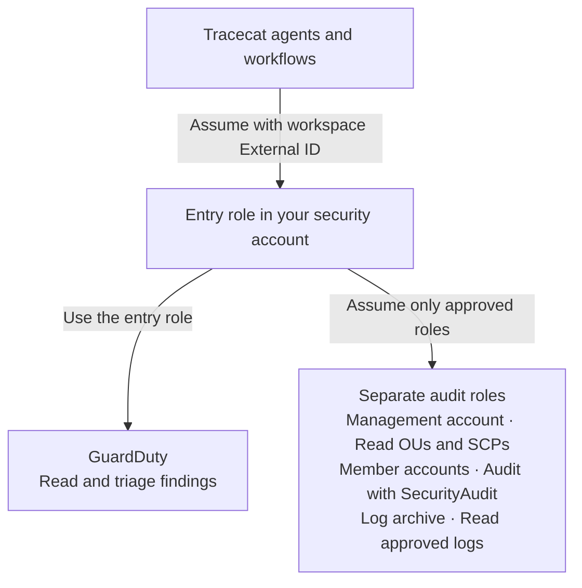

Give Tracecat agents and workflows one AWS entry role. This guide puts it in your security account, which already serves as the GuardDuty delegated administrator for the Regions you monitor.

<Prompt description="Set up the AWS connection with an AI assistant">
Help me connect Tracecat to AWS using CloudFormation or Terraform. Start with the examples at https://github.com/TracecatHQ/tracecat/tree/main/examples/connections/aws. Ask which deployment method and AWS profiles I use, whether I need one account or organization coverage, which member accounts and log buckets to approve, and whether to enable GuardDuty triage writes. Use my GuardDuty delegated administrator account for the entry role. For organization coverage, use a StackSets delegated administrator and a separate management stack if I need Organizations reads. Have me supply the Tracecat workspace External ID through a protected input. Verify the AWS account behind each profile and show me the plan or CloudFormation changes before applying. Then give me the entry role ARN and walk me through configuring the aws credential and testing it in Tracecat. If I added S3 logs, also walk me through configuring the amazon_s3 credential and running the DuckDB sample.
</Prompt>



<Info>
  The entry role trusts your Tracecat executor and requires the workspace External ID. Tracecat uses temporary sessions and can assume only the audit roles you list. Each target role grants access for its account.
</Info>

## What you can do

Use [AWS Boto3 → Call method](/tools/aws_boto3#call-method) for the API calls below. Set `role_arn` to the target audit role ARN when the check runs outside your entry account.

<AccordionGroup>
  <Accordion title="Triage GuardDuty findings">
    Use the entry role in each GuardDuty Region. Call `guardduty.list_detectors`, then `list_findings` with `DetectorId` and `get_findings` with `DetectorId` and `FindingIds`. Enable triage writes to archive or unarchive findings and submit feedback.
  </Accordion>
  <Accordion title="Map your AWS organization and audit SCPs">
    Use the management audit role. Start with `organizations.list_roots`. Call `list_organizational_units_for_parent` and `list_accounts_for_parent` with each root or OU as `ParentId`. To include inherited SCPs, call `list_policies_for_target` with `Filter: SERVICE_CONTROL_POLICY` and pass each account, ancestor OU, and root ID as `TargetId`. Read each policy with `describe_policy` and its `PolicyId`. Use [Call paginator](/tools/aws_boto3#call-paginator) for the list calls.
  </Accordion>
  <Accordion title="Query S3 logs with DuckDB">
    Configure the `amazon_s3` credential in [Connect and verify in Tracecat](#connect-and-verify-in-tracecat). Add [`core.duckdb.execute_sql`](/automations/core-actions/request-actions/sql#coreduckdbexecute_sql) to your workflow. The inputs below count events in one Parquet partition. Replace the bucket, path, Region, and audit role ARN. Omit `role_arn` if the entry role has direct bucket access.

```yaml
role_arn: arn:aws:iam::<LOG_ACCOUNT_ID>:role/TracecatSecOpsAuditRole
region_name: us-east-1
sql: |
  SELECT count(*) AS events
  FROM read_parquet('s3://<LOG_BUCKET_NAME>/<PARQUET_PREFIX>/day=2026-01-01/*.parquet')
```

  </Accordion>
  <Accordion title="Verify CloudTrail coverage">
    Use the audit role in the trail's owning account and set `region_name` to the trail's home Region. Call `cloudtrail.get_trail_status` with the full trail ARN as `Name` to check `IsLogging` and delivery errors. Call `get_event_selectors` with the ARN as `TrailName` to see which events the trail captures.
  </Accordion>
  <Accordion title="Audit IAM in each approved account">
    Use the member audit role with the AWS-managed `SecurityAudit` policy. Call `iam.list_roles` to inventory role trust policies, then `list_attached_role_policies` with `RoleName` to see which managed policies each role uses.
  </Accordion>
</AccordionGroup>

## Before you deploy

<Steps>
  <Step title="Get the workspace trust settings">
    In Tracecat, open **Credentials** and configure the AWS role credential. Copy **Principal ARN** and **External ID** from **Trust policy**. Use a protected deployment input for the External ID.
  </Step>
  <Step title="Choose the AWS accounts and Region">
    Choose one deployment Region for the IAM stacks and StackSet. To cover multiple accounts, record your organization root ID (`r-…`) or OU ID (`ou-…`), the approved member account IDs, and the management account ID if you want organization reads. Run `aws sts get-caller-identity --profile <PROFILE>` for each AWS CLI profile you use.
  </Step>
  <Step title="Prepare StackSets for organization deployments">
    In the AWS management account, confirm [all features](https://docs.aws.amazon.com/organizations/latest/userguide/orgs_manage_org_support-all-features.html) are enabled in AWS Organizations. Open **CloudFormation → StackSets** and [activate trusted access](https://docs.aws.amazon.com/AWSCloudFormation/latest/UserGuide/stacksets-orgs-activate-trusted-access.html) if prompted. Expand **Delegated administrators**. If your deployment account is absent, choose **Register delegated administrator** and enter its account ID.
  </Step>
</Steps>

<Info>
  We strongly recommend deploying StackSets from a dedicated delegated administrator account. Use the management account to register it and to deploy the separate management audit role. [Register a StackSets delegated administrator](https://docs.aws.amazon.com/AWSCloudFormation/latest/UserGuide/stacksets-orgs-delegated-admin.html).
</Info>

## Deploy the roles

Clone the [Tracecat repository](https://github.com/TracecatHQ/tracecat) and open [`examples/connections/aws`](https://github.com/TracecatHQ/tracecat/tree/main/examples/connections/aws). For a single account, deploy only the entry role. For organization access, keep the security account out of the member account allowlist because it uses the entry role directly.

<Tabs>
<Tab title="CloudFormation">

<Steps>
  <Step title="Create the entry role">
    In the security account, open **CloudFormation → Stacks** and create a stack from `cloudformation/tracecat-secops-access-role.yaml`. Set `TracecatPrincipalArn` and `ExternalId` from Tracecat. For organization access, set `TargetRoleArns` to a comma-separated list of `arn:aws:iam::<ACCOUNT_ID>:role/TracecatSecOpsAuditRole` for each approved member and the management account if needed. Leave it empty for a single account. Set `EnableGuardDutyTriage` to `true` only if you want triage writes. Acknowledge named IAM resources, create the stack, and copy the `RoleArn` output.
  </Step>
  <Step title="Deploy to approved member accounts">
    In the StackSets delegated administrator account, create a StackSet from `cloudformation/tracecat-secops-audit-role.yaml` with **Service-managed permissions**. Paste the entry role ARN into `EntryRoleArns` and acknowledge named IAM resources. Under **Deployment targets**, choose **Deploy to organizational units (OUs)**, add the root or OU ID, select the **Intersection** filter, and enter the approved member account IDs. Select one Region and turn automatic deployment off. Verify the targets on the review screen and wait for the stack instances to be up to date.
  </Step>
  <Step title="Deploy the management audit role if needed">
    In the management account, create a regular stack from `cloudformation/tracecat-secops-audit-role.yaml` with the same `EntryRoleArns`. Acknowledge named IAM resources and wait for the stack to complete.
  </Step>
</Steps>

</Tab>
<Tab title="Terraform">

<Steps>
  <Step title="Configure AWS profiles and Terraform inputs">
    In `examples/connections/aws/terraform`, follow the [Terraform example](https://github.com/TracecatHQ/tracecat/tree/main/examples/connections/aws#terraform) to configure AWS profiles and create `terraform.tfvars`. Set `organization` only for multi-account access. Supply `external_id` as a protected input and restrict access to your state.
  </Step>
  <Step title="Plan and apply">
    Run `terraform init` and `terraform plan`. Verify the selected accounts and IAM changes. Run `terraform apply`, then copy the output of `terraform output -raw role_arn`.
  </Step>
</Steps>

</Tab>
</Tabs>

## Grant read access to archived logs

For any deployment method, create a regular CloudFormation stack in the log bucket owner's account from the [log archive template](https://github.com/TracecatHQ/tracecat/blob/main/examples/connections/aws/cloudformation/tracecat-secops-log-archive-s3-policy.yaml). Use the entry role name as `RoleName` if the buckets are in your entry account. For a separate log archive account, include it in your approved member accounts and use `TracecatSecOpsAuditRole`. Set `LogBucketArns` to a comma-separated list, such as `arn:aws:s3:::example-security-logs,arn:aws:s3:::example-network-logs`. Acknowledge named IAM resources and create the stack.

For SSE-KMS logs, create a [KMS policy stack](https://github.com/TracecatHQ/tracecat/blob/main/examples/connections/aws/cloudformation/tracecat-secops-log-archive-kms-policy.yaml) in the same account for each key. Enter its full ARN as `KeyArn`, the same `RoleName`, and only the approved `LogBucketArns` encrypted by that key. Confirm the key policy allows the role to decrypt, either directly or through permissions delegated to IAM in the key's own account. If the key belongs to a different account, its key policy must authorize the external role or its account as well.

## Connect and verify in Tracecat

<Steps>
  <Step title="Save the entry role ARN">
    Save the entry stack's `RoleArn` as `AWS_ROLE_ARN` in the `aws` credential. For S3 actions or DuckDB queries against S3, set `AWS_ROLE_ARN` in the `amazon_s3` credential to the same ARN. Use role credentials with `AWS_ROLE_ARN` and leave access key fields empty.
  </Step>
  <Step title="Add AWS actions to your agent">
    Add the AWS actions to your agent's available tools. See [AI preset agent tools](/agents/ai-preset-agent#where-tools-come-from).
  </Step>
  <Step title="Verify the entry role session">
    Run [AWS Boto3 → Call method](/tools/aws_boto3#call-method) and confirm it returns the entry role session.

```yaml
service_name: sts
method_name: get_caller_identity
```

  </Step>
  <Step title="Verify a target account session">
    For a target account, add its `role_arn` and confirm the call returns that audit role's session.

```yaml
service_name: sts
method_name: get_caller_identity
role_arn: arn:aws:iam::<TARGET_ACCOUNT_ID>:role/TracecatSecOpsAuditRole
duration_seconds: 900
```

  </Step>
</Steps>

Verify each path you configured.

| Role | Check |
| --- | --- |
| Entry role | Read GuardDuty findings. If triage is enabled, archive and unarchive a sample finding. |
| Management audit role | List organizational units and service control policies (SCPs). |
| Member audit role | List IAM roles in the target account. |
| Log archive audit role | List approved buckets' objects and read a non-sensitive encrypted test object for each key. Check that an unapproved bucket rejects object listing. |

## Replace an existing entry role

<Steps>
  <Step title="Create the replacement entry role">
    Create a separate entry stack with a distinct `EntryRoleName` and the same target role allowlist. With Terraform, add a second stack resource with a distinct resource address, stack name, and role name. Keep the original stack in place during the cutover.
  </Step>
  <Step title="Allow both entry roles during cutover">
    For organization access, update the existing target role stacks to trust both entry role ARNs. Pass both ARNs as `EntryRoleArns`, or set `organization.previous_entry_role_arn` in Terraform when switching the audit stacks' entry role reference. Wait until the target stack instances are up to date.
  </Step>
  <Step title="Switch the credential and verify">
    Set `AWS_ROLE_ARN` to the new stack's `RoleArn` output in each credential you use and repeat the verification calls. Check any workflows that still need write permissions granted by the previous role. Restore the previous ARN if a check fails.
  </Step>
  <Step title="Retire the previous entry role">
    After verification and once the previous role has no callers, remove it from target role trust policies and retire its stack.
  </Step>
</Steps>

## FAQ

<AccordionGroup>
  <Accordion title="How do I connect a single account or a self-hosted deployment?">
    Deploy only the entry role and omit the organization settings. For self-hosted Tracecat, use the executor's IAM role as the principal. The default Fargate setup requires the entry role in a different account from Tracecat. See [AWS role assumption](/self-hosting/aws-fargate#aws-role-assumption).
  </Accordion>
  <Accordion title="What access do the policies grant?">
    The AWS-managed `SecurityAudit` policy grants security configuration reads in each account, including GuardDuty reads. The optional triage policy uses `Resource: '*'` so the entry role can archive findings, unarchive findings, and update feedback wherever the GuardDuty delegated administrator can manage findings. The log policy limits object listing and reads to approved buckets. See [SecurityAudit](https://docs.aws.amazon.com/aws-managed-policy/latest/reference/SecurityAudit.html) and [GuardDuty administrator permissions](https://docs.aws.amazon.com/guardduty/latest/ug/administrator_member_relationships.html).
  </Accordion>
  <Accordion title="Why does the management account need its own stack?">
    Service-managed StackSets deploy to member accounts. Create a regular stack in the management account for Organizations and CloudTrail reads. Use the full trail ARN for organization-trail checks. See [StackSet account targeting](https://docs.aws.amazon.com/AWSCloudFormation/latest/UserGuide/stacksets-orgs-associate-stackset-with-org.html).
  </Accordion>
  <Accordion title="Which key and encryption context do I use for logs?">
    Use the key that encrypted the object. An organization trail can set its own key at the trail level. Match the S3 bucket ARN for S3 Bucket Keys and the object ARN pattern for object-level encryption. See [CloudTrail KMS key policies](https://docs.aws.amazon.com/awscloudtrail/latest/userguide/create-kms-key-policy-for-cloudtrail.html).
  </Accordion>
  <Accordion title="How long do chained sessions last?">
    AWS limits the session for the second role to one hour. Set `duration_seconds` to a value from 900 to 3600.
  </Accordion>
</AccordionGroup>
