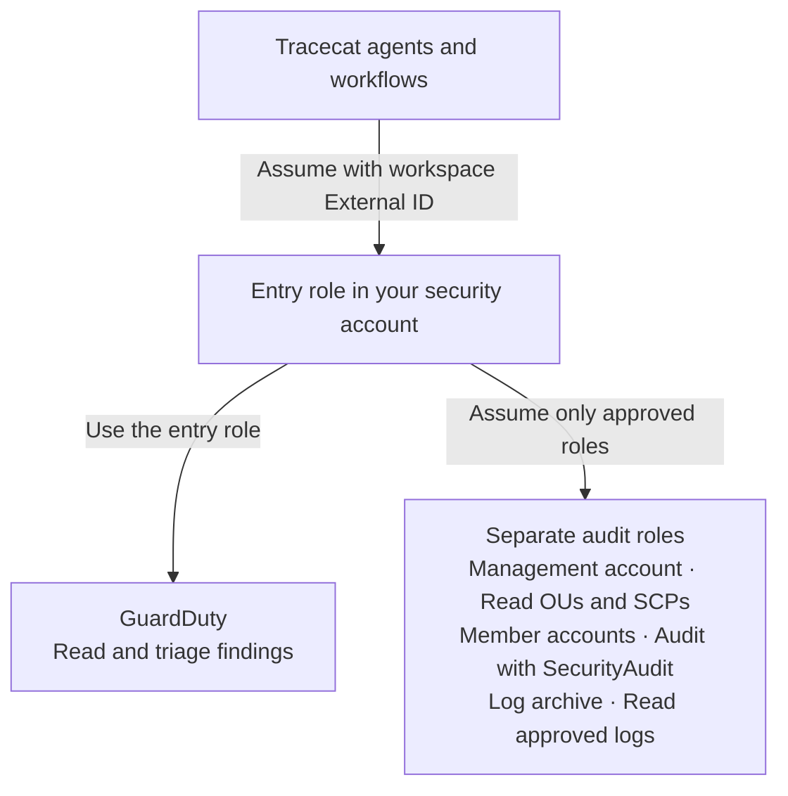

Use this setup to connect Tracecat agents and workflows to AWS. The guide assumes the entry role lives in your security account, which is also the GuardDuty delegated administrator for the Regions you monitor.



<Info>
  The entry role trusts your Tracecat executor and requires the workspace External ID. Tracecat uses temporary sessions and can assume only the audit roles you list. Each target role grants access for its account.
</Info>

## Get your workspace trust settings

1. In Tracecat, open **Credentials** and configure the AWS role credential. Copy the workspace's **Principal ARN** and **External ID** from **Trust policy**.
2. Run `aws sts get-caller-identity` to confirm you're in the entry account. Supply the External ID through a protected deployment input.

## Define the roles

Save the template as `entry-role.yaml`. Set `EnableGuardDutyTriage` to `true` to grant finding triage writes.

```yaml entry-role.yaml
AWSTemplateFormatVersion: '2010-09-09'
Parameters:
  EntryRoleName:
    Type: String
    Default: TracecatSecOpsAccessRole
  TracecatPrincipalArn:
    Type: String
  ExternalId:
    Type: String
    NoEcho: true
  TargetRoleArns:
    Type: CommaDelimitedList
    Default: ''
  EnableGuardDutyTriage:
    Type: String
    Default: 'false'
    AllowedValues: ['false', 'true']
Conditions:
  HasTargets: !Not [!Equals [!Join ['', !Ref TargetRoleArns], '']]
  CanTriageGuardDuty: !Equals [!Ref EnableGuardDutyTriage, 'true']
Resources:
  EntryRole:
    Type: AWS::IAM::Role
    Properties:
      RoleName: !Ref EntryRoleName
      MaxSessionDuration: 3600
      AssumeRolePolicyDocument:
        Version: '2012-10-17'
        Statement:
          - Effect: Allow
            Principal:
              AWS: !Ref TracecatPrincipalArn
            Action: sts:AssumeRole
            Condition:
              StringEquals:
                sts:ExternalId: !Ref ExternalId
      ManagedPolicyArns:
        - !Sub arn:${AWS::Partition}:iam::aws:policy/SecurityAudit
  AssumeTargetRoles:
    Type: AWS::IAM::RolePolicy
    Condition: HasTargets
    Properties:
      RoleName: !Ref EntryRole
      PolicyName: AssumeTracecatAuditRoles
      PolicyDocument:
        Version: '2012-10-17'
        Statement:
          - Effect: Allow
            Action: sts:AssumeRole
            Resource: !Ref TargetRoleArns
  GuardDutyTriage:
    Type: AWS::IAM::RolePolicy
    Condition: CanTriageGuardDuty
    Properties:
      RoleName: !Ref EntryRole
      PolicyName: TriageGuardDutyFindings
      PolicyDocument:
        Version: '2012-10-17'
        Statement:
          - Effect: Allow
            Action:
              - guardduty:ArchiveFindings
              - guardduty:UnarchiveFindings
              - guardduty:UpdateFindingsFeedback
            Resource: '*'
Outputs:
  RoleArn:
    Value: !GetAtt EntryRole.Arn
```

Set `TargetRoleArns` to a comma-separated list of `arn:aws:iam::<TARGET_ACCOUNT_ID>:role/TracecatSecOpsAuditRole` ARNs. For a single account, leave it empty and deploy only the entry role.

For an organization, also save `audit-role.yaml`. It gives each selected account an audit role with the AWS-managed `SecurityAudit` policy. Deploy the entry role first, then use its ARN for `EntryRoleArns`.

```yaml audit-role.yaml
AWSTemplateFormatVersion: '2010-09-09'
Parameters:
  EntryRoleArns:
    Type: CommaDelimitedList
Resources:
  AuditRole:
    Type: AWS::IAM::Role
    Properties:
      RoleName: TracecatSecOpsAuditRole
      MaxSessionDuration: 3600
      AssumeRolePolicyDocument:
        Version: '2012-10-17'
        Statement:
          - Effect: Allow
            Principal:
              AWS: !Ref EntryRoleArns
            Action: sts:AssumeRole
      ManagedPolicyArns:
        - !Sub arn:${AWS::Partition}:iam::aws:policy/SecurityAudit
```

## Deploy the roles

<Info>
  We strongly recommend deploying StackSets from a dedicated member account registered as a delegated administrator. Use the management account to enable trusted access and register the delegated administrator during initial setup. Then sign in to the delegated administrator account for deployments. [Set up a delegated administrator for StackSets](https://docs.aws.amazon.com/AWSCloudFormation/latest/UserGuide/stacksets-orgs-delegated-admin.html).
</Info>

Verify each deployment profile with `aws sts get-caller-identity` and choose one deployment Region.

<Tabs>
<Tab title="CloudFormation">

1. In the entry account, create a stack from `entry-role.yaml` in **CloudFormation → Stacks**. Enter the template parameters, acknowledge named IAM resources, and copy the `RoleArn` output. For one account, go to [Connect and verify in Tracecat](#connect-and-verify-in-tracecat).
2. In the StackSets delegated administrator account, create a StackSet from `audit-role.yaml` with **Service-managed permissions**. Set `EntryRoleArns` to the entry role ARN and acknowledge named IAM resources.
3. Select the root or target OUs and choose the **Intersection** filter to enter the approved member account IDs. Turn automatic deployment off and wait until all selected instances are up to date.
4. For management-account reads, deploy `audit-role.yaml` as a regular stack in the management account with the same `EntryRoleArns`.

</Tab>
<Tab title="Terraform">

1. Save the templates in your module directory. Configure `aws-security` and set `region`, `tracecat_principal_arn`, and `external_id`.
2. For an organization, configure `aws-stacksets` and set `organization.target_ou_id` and `organization.member_account_ids`. For management-account reads, also configure `aws-management` and set `organization.management_account_id`.
3. Set `enable_guardduty_triage` to `true` for finding triage writes. Leave `organization` unset for one account.


```hcl
terraform {
  required_providers {
    aws = {
      source  = "hashicorp/aws"
      version = "~> 6.0"
    }
  }
}

variable "region" { type = string }
variable "tracecat_principal_arn" { type = string }

variable "external_id" {
  type      = string
  sensitive = true
}

variable "enable_guardduty_triage" {
  type    = bool
  default = false
}

variable "entry_stack_name" {
  type    = string
  default = "tracecat-secops-entry"
}

variable "entry_role_name" {
  type    = string
  default = "TracecatSecOpsAccessRole"
}

variable "organization" {
  type = object({
    target_ou_id            = string
    member_account_ids      = set(string)
    management_account_id   = optional(string)
    previous_entry_role_arn = optional(string)
  })
  default = null

  validation {
    condition = var.organization == null ? true : (
      trimspace(var.organization.target_ou_id) != "" && length(var.organization.member_account_ids) > 0
    )
    error_message = "Organization mode requires a root or OU ID and at least one member account."
  }
}

provider "aws" {
  alias   = "entry"
  profile = "aws-security"
  region  = var.region
}

provider "aws" {
  alias   = "stacksets"
  profile = var.organization == null ? "aws-security" : "aws-stacksets"
  region  = var.region
}

provider "aws" {
  alias   = "management"
  profile = local.management_account_id == null ? "aws-security" : "aws-management"
  region  = var.region
}

data "aws_partition" "current" {
  provider = aws.entry
}

locals {
  audit_template        = var.organization == null ? null : file("${path.module}/audit-role.yaml")
  member_account_ids    = var.organization == null ? [] : sort(tolist(var.organization.member_account_ids))
  management_account_id = try(var.organization.management_account_id, null)
  target_account_ids = concat(
    local.member_account_ids,
    local.management_account_id == null ? [] : [local.management_account_id],
  )
  target_role_arns = [
    for account_id in local.target_account_ids :
    "arn:${data.aws_partition.current.partition}:iam::${account_id}:role/TracecatSecOpsAuditRole"
  ]
  entry_role_arns = join(",", compact([
    aws_cloudformation_stack.entry.outputs["RoleArn"],
    try(var.organization.previous_entry_role_arn, null),
  ]))
}

resource "aws_cloudformation_stack" "entry" {
  provider      = aws.entry
  name          = var.entry_stack_name
  template_body = file("${path.module}/entry-role.yaml")
  capabilities  = ["CAPABILITY_NAMED_IAM"]
  parameters = {
    EntryRoleName         = var.entry_role_name
    TracecatPrincipalArn  = var.tracecat_principal_arn
    ExternalId            = var.external_id
    TargetRoleArns        = join(",", local.target_role_arns)
    EnableGuardDutyTriage = tostring(var.enable_guardduty_triage)
  }
}

resource "aws_cloudformation_stack_set" "audit" {
  count            = var.organization == null ? 0 : 1
  provider         = aws.stacksets
  name             = "tracecat-secops-audit"
  permission_model = "SERVICE_MANAGED"
  call_as          = "DELEGATED_ADMIN"
  capabilities     = ["CAPABILITY_NAMED_IAM"]
  template_body    = local.audit_template
  parameters       = { EntryRoleArns = local.entry_role_arns }

  auto_deployment {
    enabled = false
  }
}

resource "aws_cloudformation_stack_instances" "members" {
  count          = var.organization == null ? 0 : 1
  provider       = aws.stacksets
  stack_set_name = aws_cloudformation_stack_set.audit[0].name
  call_as        = "DELEGATED_ADMIN"
  regions        = [var.region]

  deployment_targets {
    organizational_unit_ids = [var.organization.target_ou_id]
    account_filter_type     = "INTERSECTION"
    accounts                = local.member_account_ids
  }
}

resource "aws_cloudformation_stack" "management" {
  count         = local.management_account_id == null ? 0 : 1
  provider      = aws.management
  name          = "tracecat-secops-audit"
  template_body = local.audit_template
  capabilities  = ["CAPABILITY_NAMED_IAM"]
  parameters    = { EntryRoleArns = local.entry_role_arns }
}

output "role_arn" {
  value = aws_cloudformation_stack.entry.outputs["RoleArn"]
}
```

Protect Terraform state. Run `terraform init` and review `terraform plan` before applying.

</Tab>
<Tab title="Pulumi">

1. In a TypeScript project with `@pulumi/aws` and `@pulumi/pulumi`, save the templates and configure `aws-security`. Set `region` and `tracecatPrincipalArn`. Use `pulumi config set --secret externalId` for the workspace External ID.
2. For an organization, configure `aws-stacksets` and set `organization.targetOuId` and `organization.memberAccountIds`. For management-account reads, also configure `aws-management` and set `organization.managementAccountId`.
3. Set `enableGuardDutyTriage` to `true` for finding triage writes. Leave `organization` unset for one account.

```typescript
import * as aws from "@pulumi/aws";
import * as pulumi from "@pulumi/pulumi";
import { readFileSync } from "node:fs";

type Organization = {
  targetOuId: string;
  memberAccountIds: string[];
  managementAccountId?: string;
  previousEntryRoleArn?: string;
};

const config = new pulumi.Config();
const region = config.require("region");
const organization = config.getObject<Organization>("organization");
if (organization && (!organization.targetOuId || !organization.memberAccountIds?.length)) {
  throw new Error("Organization mode requires a root or OU ID and at least one member account.");
}

const entryProvider = new aws.Provider("entry", { profile: "aws-security", region });
const management = organization?.managementAccountId;
const targetAccounts = [...(organization?.memberAccountIds ?? []), ...(management ? [management] : [])];
const partition = aws.getPartitionOutput({}, { provider: entryProvider });
const targetRoleArns = partition.partition.apply((value) =>
  targetAccounts.map((id) => `arn:${value}:iam::${id}:role/TracecatSecOpsAuditRole`).join(","),
);

const entry = new aws.cloudformation.Stack("entry", {
  name: config.get("entryStackName") ?? "tracecat-secops-entry",
  templateBody: readFileSync("entry-role.yaml", "utf8"),
  capabilities: ["CAPABILITY_NAMED_IAM"],
  parameters: {
    EntryRoleName: config.get("entryRoleName") ?? "TracecatSecOpsAccessRole",
    TracecatPrincipalArn: config.require("tracecatPrincipalArn"),
    ExternalId: config.requireSecret("externalId"),
    TargetRoleArns: targetRoleArns,
    EnableGuardDutyTriage: String(config.getBoolean("enableGuardDutyTriage") ?? false),
  },
}, { provider: entryProvider });

export const roleArn = entry.outputs.apply((outputs) => outputs.RoleArn);
if (organization) {
  const provider = new aws.Provider("stacksets", { profile: "aws-stacksets", region });
  const auditTemplate = readFileSync("audit-role.yaml", "utf8");
  const entryRoleArns = roleArn.apply((arn) =>
    [arn, organization.previousEntryRoleArn].filter(Boolean).join(","),
  );
  const audit = new aws.cloudformation.StackSet("audit", {
    name: "tracecat-secops-audit",
    permissionModel: "SERVICE_MANAGED",
    callAs: "DELEGATED_ADMIN",
    capabilities: ["CAPABILITY_NAMED_IAM"],
    autoDeployment: { enabled: false },
    templateBody: auditTemplate,
    parameters: { EntryRoleArns: entryRoleArns },
  }, { provider });

  new aws.cloudformation.StackInstances("members", {
    stackSetName: audit.name,
    callAs: "DELEGATED_ADMIN",
    regions: [region],
    deploymentTargets: {
      organizationalUnitIds: [organization.targetOuId],
      accountFilterType: "INTERSECTION",
      accounts: organization.memberAccountIds,
    },
  }, { provider });

  if (management) {
    const managementProvider = new aws.Provider("management", { profile: "aws-management", region });
    new aws.cloudformation.Stack("management", {
      name: "tracecat-secops-audit",
      templateBody: auditTemplate,
      capabilities: ["CAPABILITY_NAMED_IAM"],
      parameters: { EntryRoleArns: entryRoleArns },
    }, { provider: managementProvider });
  }
}
```

Review `pulumi preview` before running `pulumi up`.

</Tab>
</Tabs>

## Grant read access to archived logs

Attach this policy to the audit role in the log archive account. For a single-account setup, attach it to the entry role. Add every approved bucket ARN to both listing statements and every matching object ARN to the read statement.

```json
{
  "Version": "2012-10-17",
  "Statement": [
    {
      "Effect": "Allow",
      "Action": "s3:ListBucket",
      "Resource": ["arn:aws:s3:::<LOG_BUCKET_NAME>"]
    },
    {
      "Effect": "Allow",
      "Action": "s3:GetObject",
      "Resource": ["arn:aws:s3:::<LOG_BUCKET_NAME>/*"]
    },
    {
      "Effect": "Deny",
      "Action": "s3:ListBucket",
      "NotResource": ["arn:aws:s3:::<LOG_BUCKET_NAME>"]
    }
  ]
}
```

For SSE-KMS logs, add a statement like this for each key that encrypts an approved log source. Confirm the key policy authorizes the role or enables IAM grants in its account.

```json
{
  "Effect": "Allow",
  "Action": "kms:Decrypt",
  "Resource": "arn:aws:kms:<LOG_REGION>:<LOG_ACCOUNT_ID>:key/<KEY_ID>",
  "Condition": {
    "StringEquals": {
      "kms:ViaService": "s3.<LOG_REGION>.amazonaws.com"
    },
    "StringLike": {
      "kms:EncryptionContext:aws:s3:arn": [
        "arn:aws:s3:::<LOG_BUCKET_NAME>",
        "arn:aws:s3:::<LOG_BUCKET_NAME>/*"
      ]
    }
  }
}
```

## Connect and verify in Tracecat

1. Save the entry stack's `RoleArn` as `AWS_ROLE_ARN` in the `aws` credential. If you use `tools.amazon_s3`, set `AWS_ROLE_ARN` in the `amazon_s3` credential to the same ARN.
2. Add the AWS actions to your agent's available tools. See [AI preset agent tools](/agents/ai-preset-agent#where-tools-come-from).
3. Run [AWS Boto3 → Call method](/tools/aws_boto3#call-method) and confirm it returns the entry role session.

```yaml
service_name: sts
method_name: get_caller_identity
```

For a target account, add its `role_arn` and confirm the call returns that audit role's session.

```yaml
service_name: sts
method_name: get_caller_identity
role_arn: arn:aws:iam::<TARGET_ACCOUNT_ID>:role/TracecatSecOpsAuditRole
duration_seconds: 900
```

Verify each path you configured.

| Role | Check |
| --- | --- |
| Entry role | Read GuardDuty findings. If triage is enabled, archive and unarchive a sample finding. |
| Management audit role | List organizational units and service control policies (SCPs). |
| Member audit role | List IAM roles in the target account. |
| Log archive audit role | List approved buckets' objects and read a non-sensitive encrypted test object for each key. Check that an unapproved bucket rejects object listing. |

## Replace an existing entry role

1. Create a separate entry stack with a distinct `EntryRoleName` and the same target role allowlist. With Terraform or Pulumi, add a second stack resource with a distinct resource address, stack name, and role name. Keep the original stack in place during the cutover.
2. For organization access, update the existing target role stacks to trust both entry role ARNs. Pass both ARNs as `EntryRoleArns`, or set `organization.previous_entry_role_arn` in Terraform or `organization.previousEntryRoleArn` in Pulumi when switching the audit stacks' entry role reference. Wait until the target stack instances are up to date.
3. Set `AWS_ROLE_ARN` to the new stack's `RoleArn` output and repeat the verification calls. Check any workflows that still need write permissions granted by the previous role. Restore the previous ARN if a check fails.
4. After verification and once the previous role has no callers, remove it from target role trust policies and retire its stack.

## FAQ

<AccordionGroup>
  <Accordion title="How do I connect a single account or a self-hosted deployment?">
    Deploy only the entry role and omit the organization settings. For self-hosted Tracecat, use the executor's IAM role as the principal. The default Fargate setup requires the entry role in a different account from Tracecat. See [AWS role assumption](/self-hosting/aws-fargate#aws-role-assumption).
  </Accordion>
  <Accordion title="What access do the policies grant?">
    The AWS-managed `SecurityAudit` policy grants security configuration reads in each account, including GuardDuty reads. The optional triage policy uses `Resource: '*'` so the entry role can archive findings, unarchive findings, and update feedback wherever the GuardDuty delegated administrator can manage findings. The log policy limits object listing and reads to approved buckets. See [SecurityAudit](https://docs.aws.amazon.com/aws-managed-policy/latest/reference/SecurityAudit.html) and [GuardDuty administrator permissions](https://docs.aws.amazon.com/guardduty/latest/ug/administrator_member_relationships.html).
  </Accordion>
  <Accordion title="Why does the management account need its own stack?">
    Service-managed StackSets deploy to member accounts. Create a regular stack in the management account for Organizations and CloudTrail reads. Use the full trail ARN for organization-trail checks. See [StackSet account targeting](https://docs.aws.amazon.com/AWSCloudFormation/latest/UserGuide/stacksets-orgs-associate-stackset-with-org.html).
  </Accordion>
  <Accordion title="Which key and encryption context do I use for logs?">
    Use the key that encrypted the object. An organization trail can set its own key at the trail level. Match the S3 bucket ARN for S3 Bucket Keys and the object ARN pattern for object-level encryption. See [CloudTrail KMS key policies](https://docs.aws.amazon.com/awscloudtrail/latest/userguide/create-kms-key-policy-for-cloudtrail.html).
  </Accordion>
  <Accordion title="How long do chained sessions last?">
    AWS limits the session for the second role to one hour. Set `duration_seconds` to a value from 900 to 3600.
  </Accordion>
</AccordionGroup>
