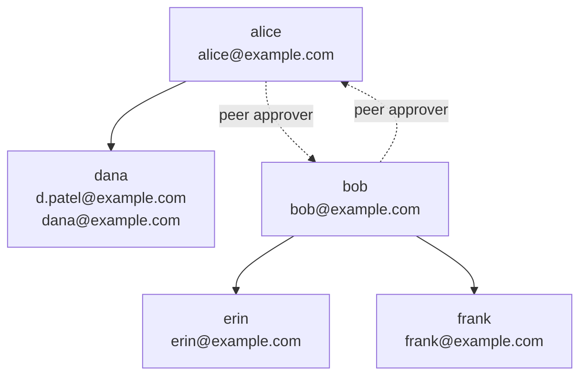

# org-chart

Use this skill when a message asks a person to approve access. It tells you who the approver is.

This skill is the only record of the reporting structure. No table and no other source holds it. Read the manager from this file.

> **This file is a template.** Everything under "The org chart" and "Lookup table" is example data, using the reserved `example.com` domain. Replace it with your own people before you publish the skill. Everything below those two sections is the reusable part and needs no change.

## The org chart

## Lookup table

A person can have more than one email address. Every address of a person resolves to the same manager.

| Person | Email addresses | Manager | Manager email |
| --- | --- | --- | --- |
| dana | `d.patel@example.com`, `dana@example.com` | alice | `alice@example.com` |
| erin | `erin@example.com` | bob | `bob@example.com` |
| frank | `frank@example.com` | bob | `bob@example.com` |
| alice | `alice@example.com` | bob (peer) | `bob@example.com` |
| bob | `bob@example.com` | alice (peer) | `alice@example.com` |

Confirm each address against a real source before you trust it. Audit logs are a good source, because they show the addresses people actually sign in with.

`d.patel@example.com` and `dana@example.com` are two addresses of one person. Both are real and both are correct. Both resolve to alice. Record every address a person uses, not only the obvious one.

## Peer approvers at the top of the chart

alice and bob have no manager above them. They approve for each other:

- An app connected by alice is approved by bob.
- An app connected by bob is approved by alice.

This keeps the rule that nobody approves their own access. Return the peer the same way you would return a manager. Do not mark either of them as having no approver.

## The approval rule

The manager of a person approves the access of that person. A person never approves their own access.

- A person connects an app. Send the approval request to the manager of that person.
- Do not send the approval request to the person who connected the app.
- Do not send the approval request to a second approver. One manager is enough.

## The resolution contract

A consuming agent gets the email address of the person who connected an app. It returns the email address of the manager. Follow these steps.

1. Find the row in the lookup table that holds the given address. Compare the addresses in lower case.
2. If the row has a manager email, return that manager email.
3. If the row says `not recorded`, return an empty string for the manager email. State that no manager is recorded for that person.
4. If no row holds the given address, return an empty string for the manager email. State that the person is not in the org chart.

Three rules apply to every result.

- Never return the given address as its own manager email.
- Never guess a manager.
- Never use a default person, a team address, or a shared mailbox as the manager.

## Do not build an address

Do not make an email address from a name. Read the address from the lookup table. A person's address does not always contain their name.

## When the chart has no answer

Two gaps are possible. Stop in both and name the gap.

- The person is in the table, but the manager column says `not recorded`.
- The person is not in the table at all.

In both cases:

- The manager email is an empty string.
- Say which address you could not resolve.
- Say that a human must choose the approver.

## How current this is

A human writes this chart by hand. Record the date you last edited it here, in place of this sentence.

It has no automatic source. Nothing keeps it in step with a change of job, a new joiner, or a new email address.

Distrust the chart if any of these is true:

- The date above is old.
- An address in the access request is not in the table.
- The reporting line does not match what you know from another source.

## A note on scale

This design holds a small chart as a hand-written file on purpose. It suits a team of a few dozen people, where the structure changes rarely and a human can keep it right.

If your organisation is larger, or the structure changes often, read the reporting line from your identity provider instead. The rules in this file still apply. Only the source of the data changes.
