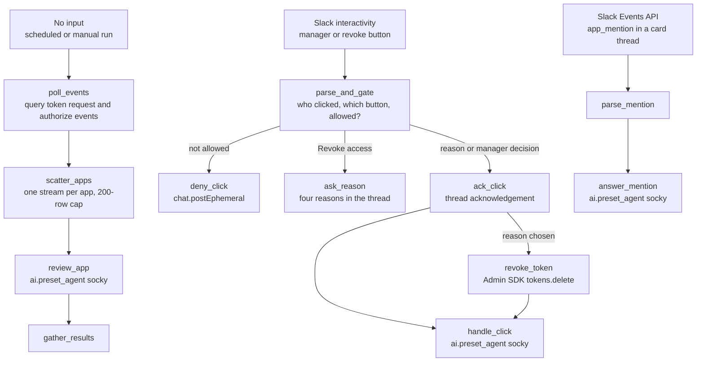

# Google OAuth app lifecycle workflow

One workflow with three entry points and 12 steps. With no input it polls the logs. With a Slack button payload it handles the click. With a Slack mention it answers a question in a card's thread. Settings: environment `default`, timeout 300 seconds.

Judgement goes to `ai.preset_agent`. Reshaping goes to `core.transform.*`. Never `core.script.run_python`. Deterministic: the log query, who may click, the Google token delete. Agentic: the assessment, the research, the prose.

Build with the schedule off, `revoke_approvers` empty and `dry_run` true.

## Diagram



A mention carries no `action_id`. Route it by looking its thread timestamp up in `slack_work_objects`. An `oauth:` reference belongs here.

## Entrypoint inputs

Declare every field below in `expects`, each with its default. The input schema is strict.

| Field | Type, default | Sent by | Use |
|---|---|---|---|
| `payload` | `str`, `''` | Slack interactivity | Raw `block_actions` JSON. Non-empty selects the click lane. |
| `event` | `dict[str, any]`, `{}` | Slack Events API, or a router | `app_mention` selects the mention lane. Empty on every other run. |
| `lookback_minutes` | `int`, `15` | Schedule, manual run | How far back to query. Raise it to replay historical events. |
| `slack_channel` | `str`, `C0123456789` | Workflow default | Channel for new cards on the poll lane. |
| `admin_subject` | `str`, `admin@example.com` | Workflow default | Super-admin the service account impersonates. A Google 403 is usually a missing subject, not a missing scope. |
| `revoke_approvers` | `list[str]`, `[]` | Workflow default | Slack user IDs who may choose a revoke reason. Empty means nobody. |
| `dry_run` | `bool`, `true` | Workflow default | When true, `revoke_token` and `deny_click` do not run. Declare this. The steps read `TRIGGER.dry_run`. |

## Tables

Create these before the first run. `google_oauth_app_reviews` and `slack_work_objects` need a unique index on their first column, because upsert uses it. `oauth_scope_risk` is read-only to the agent.

| Table | Columns | Written by | Read by |
|---|---|---|---|
| `google_oauth_app_reviews` | `client_id` (text, unique), `app_name`, `project_number`, `scopes` (JSON), `assessment` (JSON), `research` (JSON), `policy_floor`, `case_id`, `case_number`, `message_ts`, `slack_channel`, `users` (JSON), `first_seen`, `last_seen`, `last_stage` | Socky | Socky, later poll runs |
| `oauth_scope_risk` | `scope` (text, unique), `risk`, `rationale` | You, once | Socky. **Read-only to the agent.** |
| `slack_work_objects` | `external_ref_id` (text, unique, `oauth:<short name>`), `case_id`, `channel`, `message_ts`, `entity` (JSON) | Socky | Socky, and a router looking up a mention's `thread_ts`. Shared with example 001. |

Seed `oauth_scope_risk` yourself. A missing row changes the verdict, so do not leave it empty.

## Returns

| Field | Value |
|---|---|
| `lane` | `poll`, `slack_interaction` or `thread_mention` |
| `apps_found` | Row count from the log query, or 0 |
| `results` | Gathered Socky outputs from the poll lane |
| `click` | Socky output from the click lane |
| `mention` | Socky output from the mention lane |

## Steps

### poll_events

Runs when there is no Slack payload and no Slack event. Queries Workspace `token` `request` and `authorize` events over `lookback_minutes`, groups them to one row per app, and skips service accounts (numeric client IDs). Caps at 200 rows. The query below is written for a ClickHouse-style log store. Rewrite the endpoint, the secret and `<workspace-token-logs>` for yours.

Each row is a prompt of the form `OAuth app lifecycle <user>|<client_id>` plus JSON, which is what makes Socky load `google-oauth-app-lifecycle`.

```yaml
- action: core.http_request
  args:
    headers:
      Authorization: Basic ${{ SECRETS.siem.SIEM_API_TOKEN }}
      Content-Type: application/json
    method: POST
    payload:
      limit: 201
      parameters: {}
      query: SELECT concat('OAuth app lifecycle ', primary_user, '|', client_id, '\n', toJSONString(map('client_id',
        client_id, 'app_name', app_name, 'primary_user', primary_user, 'users', arrayStringConcat(users,
        ','), 'scopes', arrayStringConcat(scopes, ','), 'scope_count', toString(length(scopes)), 'authorized_users',
        arrayStringConcat(authorized_users, ','), 'requested_users', arrayStringConcat(requested_users,
        ','), 'stages', arrayStringConcat(stages, ','), 'event_time', event_time))) AS review_prompt FROM
        (SELECT client_id, app_name, if(length(users) > 0, users[1], '') AS primary_user, users, scopes,
        authorized_users, requested_users, stages, event_time FROM (SELECT JSONExtractString(arrayFirst(p
        -> JSONExtractString(p,'name')='client_id', JSONExtractArrayRaw(ev,'parameters')),'value') AS
        client_id, argMax(JSONExtractString(arrayFirst(p -> JSONExtractString(p,'name')='app_name', JSONExtractArrayRaw(ev,'parameters')),'value'),
        JSONExtractString(rawLog,'id','time')) AS app_name, arrayDistinct(arrayFlatten(groupArray(JSONExtract(arrayFirst(p
        -> JSONExtractString(p,'name')='scope', JSONExtractArrayRaw(ev,'parameters')),'multiValue','Array(String)'))))
        AS scopes, groupUniqArray(lower(trim(JSONExtractString(rawLog,'actor','email')))) AS users, groupUniqArrayIf(lower(trim(JSONExtractString(rawLog,'actor','email'))),
        JSONExtractString(ev,'name')='authorize') AS authorized_users, groupUniqArrayIf(lower(trim(JSONExtractString(rawLog,'actor','email'))),
        JSONExtractString(ev,'name')='request') AS requested_users, groupUniqArray(JSONExtractString(ev,'name'))
        AS stages, max(JSONExtractString(rawLog,'id','time')) AS event_time FROM <workspace-token-logs>
        ARRAY JOIN JSONExtractArrayRaw(rawLog,'events') AS ev WHERE receivedAt >= now() - INTERVAL ${{
        TRIGGER.lookback_minutes }} MINUTE AND JSONExtractString(rawLog,'id','applicationName')='token'
        AND JSONExtractString(ev,'name') IN ('request','authorize') AND endsWith(client_id,'.apps.googleusercontent.com')
        GROUP BY client_id ORDER BY event_time DESC LIMIT 201))
      source: google-oauth-app-lifecycle
    timeout: 60
    url: <siem-query-url>
  ref: poll_events
  retry_policy:
    max_attempts: 2
    timeout: 120
  run_if: ${{ FN.length(TRIGGER.payload) == 0 && FN.lookup(TRIGGER.event, 'type') == None }}
```

### scatter_apps

Fans out over the query rows, one stream per app. Fails closed if the query did not complete, the column contract does not match, or there are more than 200 rows. The agent cannot choose how much work to create.

```yaml
- action: core.transform.scatter
  args:
    collection: ${{ FN.flatten(ACTIONS.poll_events.result.data.result.rows) if (ACTIONS.poll_events.result.data.success
      == True && ACTIONS.poll_events.result.data.result.status == 'completed' && ACTIONS.poll_events.result.data.result.error
      == '' && ACTIONS.poll_events.result.data.result.columns == ['review_prompt'] && ACTIONS.poll_events.result.data.result.rows
      != None && FN.length(ACTIONS.poll_events.result.data.result.rows) <= 200) else FN.deserialize_json('siem_query_failed_or_column_contract_mismatch_or_over_200_rows')
      }}
    interval: 0.5
  depends_on:
  - poll_events
  ref: scatter_apps
  retry_policy:
    max_attempts: 1
    timeout: 300
```

### review_app

Runs Socky once per app. `max_tool_calls` stays at 40: over 40 fails silently.

```yaml
- action: ai.preset_agent
  args:
    instructions: Post the Work Object card and every thread reply for this run in Slack channel ${{ TRIGGER.slack_channel
      }}, and in no other channel.
    max_requests: 120
    max_tool_calls: 40
    preset: socky
    user_prompt: ${{ ACTIONS.scatter_apps.result }}
  depends_on:
  - scatter_apps
  ref: review_app
  retry_policy:
    max_attempts: 1
    timeout: 1800
```

### gather_results

Collects the Socky outputs. A failed app fails the gather.

```yaml
- action: core.transform.gather
  args:
    error_strategy: raise
    items: ${{ ACTIONS.review_app.result.output }}
  depends_on:
  - review_app
  ref: gather_results
  retry_policy:
    max_attempts: 1
    timeout: 300
```

### parse_and_gate

Runs when `payload` is non-empty. One reshape that outputs `allowed`. The manager's Slack ID is in part 3 of the button `block_id` (`oauth:<user>:<client_id>:<manager_slack_id>`). Revoke is gated on `revoke_approvers`. Everything downstream carries `run_if` on `allowed`.

```yaml
- action: core.transform.reshape
  args:
    value:
      acted_as_test_approver: ${{ FN.is_in(FN.lookup(FN.at(FN.lookup(FN.deserialize_json(TRIGGER.payload),
        'actions'), 0), 'action_id'), ['oauth_mgr_approve', 'oauth_mgr_deny']) && (FN.at(FN.split(FN.lookup(FN.at(FN.lookup(FN.deserialize_json(TRIGGER.payload),
        'actions'), 0), 'block_id'), ':'), 3) if FN.length(FN.split(FN.lookup(FN.at(FN.lookup(FN.deserialize_json(TRIGGER.payload),
        'actions'), 0), 'block_id'), ':')) > 3 else 'none') != FN.lookup(FN.lookup(FN.deserialize_json(TRIGGER.payload),
        'user'), 'id') }}
      action_id: ${{ FN.lookup(FN.at(FN.lookup(FN.deserialize_json(TRIGGER.payload), 'actions'), 0), 'action_id')
        }}
      allowed: ${{ (FN.is_in(FN.lookup(FN.lookup(FN.deserialize_json(TRIGGER.payload), 'user'), 'id'),
        TRIGGER.revoke_approvers) if FN.is_in(FN.lookup(FN.at(FN.lookup(FN.deserialize_json(TRIGGER.payload),
        'actions'), 0), 'action_id'), ['oauth_revoke', 'oauth_revoke_not_needed', 'oauth_revoke_excess_scope',
        'oauth_revoke_untrusted', 'oauth_revoke_compromise']) else False) || (FN.is_in(FN.lookup(FN.at(FN.lookup(FN.deserialize_json(TRIGGER.payload),
        'actions'), 0), 'action_id'), ['oauth_mgr_approve', 'oauth_mgr_deny']) && (FN.at(FN.split(FN.lookup(FN.at(FN.lookup(FN.deserialize_json(TRIGGER.payload),
        'actions'), 0), 'block_id'), ':'), 3) if FN.length(FN.split(FN.lookup(FN.at(FN.lookup(FN.deserialize_json(TRIGGER.payload),
        'actions'), 0), 'block_id'), ':')) > 3 else 'none') == FN.lookup(FN.lookup(FN.deserialize_json(TRIGGER.payload),
        'user'), 'id')) }}
      block_id: ${{ FN.lookup(FN.at(FN.lookup(FN.deserialize_json(TRIGGER.payload), 'actions'), 0), 'block_id')
        }}
      channel: ${{ FN.lookup(FN.lookup(FN.deserialize_json(TRIGGER.payload), 'channel'), 'id') }}
      clicked_by: ${{ FN.lookup(FN.lookup(FN.deserialize_json(TRIGGER.payload), 'user'), 'id') }}
      decision: ${{ 'approved' if FN.lookup(FN.at(FN.lookup(FN.deserialize_json(TRIGGER.payload), 'actions'),
        0), 'action_id') == 'oauth_mgr_approve' else ('not approved' if FN.lookup(FN.at(FN.lookup(FN.deserialize_json(TRIGGER.payload),
        'actions'), 0), 'action_id') == 'oauth_mgr_deny' else 'revoked') }}
      is_escalation: ${{ FN.lookup(FN.at(FN.lookup(FN.deserialize_json(TRIGGER.payload), 'actions'), 0),
        'action_id') == 'oauth_revoke_compromise' }}
      is_manager_decision: ${{ FN.is_in(FN.lookup(FN.at(FN.lookup(FN.deserialize_json(TRIGGER.payload),
        'actions'), 0), 'action_id'), ['oauth_mgr_approve', 'oauth_mgr_deny']) }}
      is_revoke: ${{ FN.is_in(FN.lookup(FN.at(FN.lookup(FN.deserialize_json(TRIGGER.payload), 'actions'),
        0), 'action_id'), ['oauth_revoke_not_needed', 'oauth_revoke_excess_scope', 'oauth_revoke_untrusted',
        'oauth_revoke_compromise']) }}
      is_revoke_ask: ${{ FN.lookup(FN.at(FN.lookup(FN.deserialize_json(TRIGGER.payload), 'actions'), 0),
        'action_id') == 'oauth_revoke' }}
      manager_slack_id: ${{ FN.at(FN.split(FN.lookup(FN.at(FN.lookup(FN.deserialize_json(TRIGGER.payload),
        'actions'), 0), 'block_id'), ':'), 3) if FN.length(FN.split(FN.lookup(FN.at(FN.lookup(FN.deserialize_json(TRIGGER.payload),
        'actions'), 0), 'block_id'), ':')) > 3 else 'none' }}
      message_ts: ${{ FN.lookup(FN.lookup(FN.deserialize_json(TRIGGER.payload), 'message'), 'ts') }}
      response_url: ${{ FN.lookup(FN.deserialize_json(TRIGGER.payload), 'response_url') }}
      revoke_reason: ${{ 'not needed for work' if FN.lookup(FN.at(FN.lookup(FN.deserialize_json(TRIGGER.payload),
        'actions'), 0), 'action_id') == 'oauth_revoke_not_needed' else ('more access than the app needs'
        if FN.lookup(FN.at(FN.lookup(FN.deserialize_json(TRIGGER.payload), 'actions'), 0), 'action_id')
        == 'oauth_revoke_excess_scope' else ('publisher not trusted' if FN.lookup(FN.at(FN.lookup(FN.deserialize_json(TRIGGER.payload),
        'actions'), 0), 'action_id') == 'oauth_revoke_untrusted' else ('suspected compromise' if FN.lookup(FN.at(FN.lookup(FN.deserialize_json(TRIGGER.payload),
        'actions'), 0), 'action_id') == 'oauth_revoke_compromise' else ''))) }}
      target_client: ${{ FN.at(FN.split(FN.lookup(FN.at(FN.lookup(FN.deserialize_json(TRIGGER.payload),
        'actions'), 0), 'block_id'), ':'), 2) if FN.length(FN.split(FN.lookup(FN.at(FN.lookup(FN.deserialize_json(TRIGGER.payload),
        'actions'), 0), 'block_id'), ':')) > 2 else '' }}
      target_user: ${{ FN.at(FN.split(FN.lookup(FN.at(FN.lookup(FN.deserialize_json(TRIGGER.payload),
        'actions'), 0), 'block_id'), ':'), 1) if FN.length(FN.split(FN.lookup(FN.at(FN.lookup(FN.deserialize_json(TRIGGER.payload),
        'actions'), 0), 'block_id'), ':')) > 1 else '' }}
      thread_ts: ${{ FN.lookup(FN.lookup(FN.deserialize_json(TRIGGER.payload), 'message'), 'thread_ts')
        }}
      value_field: ${{ FN.lookup(FN.at(FN.lookup(FN.deserialize_json(TRIGGER.payload), 'actions'), 0),
        'value') }}
  ref: parse_and_gate
  retry_policy:
    max_attempts: 1
    timeout: 60
  run_if: ${{ FN.length(TRIGGER.payload) > 0 }}
```

### deny_click

Runs when the click is not allowed and `dry_run` is false. Sends an ephemeral message only the person who clicked sees.

```yaml
- action: tools.slack_sdk.call_method
  args:
    params:
      channel: ${{ ACTIONS.parse_and_gate.result.channel }}
      text: ${{ 'Only an approved security responder can revoke OAuth access. Ask the security team to
        action this card.' if ACTIONS.parse_and_gate.result.is_revoke else 'Only the manager named on
        this card can approve this access. You are not that person.' }}
      user: ${{ ACTIONS.parse_and_gate.result.clicked_by }}
    sdk_method: chat_postEphemeral
  depends_on:
  - parse_and_gate
  ref: deny_click
  retry_policy:
    max_attempts: 1
    timeout: 60
  run_if: ${{ not TRIGGER.dry_run && (not ACTIONS.parse_and_gate.result.allowed ) }}
```

### ask_reason

Runs when the click is `oauth_revoke`. Posts four fixed reasons in the thread and calls nothing in Google. Choosing a reason is a second click. The reasons are yours to set; these four are countable.

```yaml
- action: tools.slack_sdk.call_method
  args:
    params:
      blocks:
      - text:
          text: ${{ FN.concat('<@', ACTIONS.parse_and_gate.result.clicked_by, '> is revoking access for
            `', ACTIONS.parse_and_gate.result.target_user, '`. Choose a reason. The reason is recorded
            on the case, so pick the one that is true rather than the nearest one. Only an approved security
            responder can complete this.') }}
          type: mrkdwn
        type: section
      - block_id: ${{ ACTIONS.parse_and_gate.result.block_id }}
        elements:
        - action_id: oauth_revoke_not_needed
          confirm:
            confirm:
              text: Revoke
              type: plain_text
            deny:
              text: Cancel
              type: plain_text
            style: danger
            text:
              text: '${{ FN.concat(''Reason: not needed for work. This removes the token `'', ACTIONS.parse_and_gate.result.target_user,
                ''` holds for this app. It does not block the app, and that person can connect it again.'')
                }}'
              type: mrkdwn
            title:
              text: Revoke access?
              type: plain_text
          text:
            text: Not needed for work
            type: plain_text
          type: button
          value: ${{ ACTIONS.parse_and_gate.result.value_field }}
        - action_id: oauth_revoke_excess_scope
          confirm:
            confirm:
              text: Revoke
              type: plain_text
            deny:
              text: Cancel
              type: plain_text
            style: danger
            text:
              text: '${{ FN.concat(''Reason: more access than the app needs. This removes the token `'',
                ACTIONS.parse_and_gate.result.target_user, ''` holds for this app. It does not block the
                app, and that person can connect it again.'') }}'
              type: mrkdwn
            title:
              text: Revoke access?
              type: plain_text
          text:
            text: Too much access
            type: plain_text
          type: button
          value: ${{ ACTIONS.parse_and_gate.result.value_field }}
        - action_id: oauth_revoke_untrusted
          confirm:
            confirm:
              text: Revoke
              type: plain_text
            deny:
              text: Cancel
              type: plain_text
            style: danger
            text:
              text: '${{ FN.concat(''Reason: publisher not trusted. This removes the token `'', ACTIONS.parse_and_gate.result.target_user,
                ''` holds for this app. It does not block the app, and that person can connect it again.'')
                }}'
              type: mrkdwn
            title:
              text: Revoke access?
              type: plain_text
          text:
            text: Publisher not trusted
            type: plain_text
          type: button
          value: ${{ ACTIONS.parse_and_gate.result.value_field }}
        - action_id: oauth_revoke_compromise
          confirm:
            confirm:
              text: Revoke and escalate
              type: plain_text
            deny:
              text: Cancel
              type: plain_text
            style: danger
            text:
              text: '${{ FN.concat(''Reason: suspected compromise. This removes the token `'', ACTIONS.parse_and_gate.result.target_user,
                ''` holds for this app and tags the case for escalation. Revoking one token does not contain
                a consent-phishing attack: the attacker may hold others, so treat this as the start of
                an investigation.'') }}'
              type: mrkdwn
            title:
              text: Treat as an incident?
              type: plain_text
          style: danger
          text:
            text: Suspected compromise
            type: plain_text
          type: button
          value: ${{ ACTIONS.parse_and_gate.result.value_field }}
        type: actions
      channel: ${{ ACTIONS.parse_and_gate.result.channel }}
      text: Choose a reason to revoke this access.
      thread_ts: ${{ ACTIONS.parse_and_gate.result.thread_ts if ACTIONS.parse_and_gate.result.thread_ts
        != None else ACTIONS.parse_and_gate.result.message_ts }}
      unfurl_links: false
    sdk_method: chat_postMessage
  depends_on:
  - parse_and_gate
  ref: ask_reason
  retry_policy:
    max_attempts: 2
    timeout: 30
  run_if: ${{ ACTIONS.parse_and_gate.result.allowed && ACTIONS.parse_and_gate.result.is_revoke_ask }}
```

### ack_click

Runs on an allowed manager decision or an allowed revoke reason. Posts a line in the thread so the channel can see the click was received. Acknowledge within three seconds: this step is the acknowledgement, not Socky.

```yaml
- action: tools.slack_sdk.call_method
  args:
    params:
      channel: ${{ ACTIONS.parse_and_gate.result.channel }}
      text: ${{ (FN.concat('<@', ACTIONS.parse_and_gate.result.clicked_by, '> is revoking the token that
        `', ACTIONS.parse_and_gate.result.target_user, '` holds for this app.') if ACTIONS.parse_and_gate.result.is_revoke
        else FN.concat('<@', ACTIONS.parse_and_gate.result.clicked_by, '> recorded `', ACTIONS.parse_and_gate.result.target_user,
        '` as ', ACTIONS.parse_and_gate.result.decision, ' for this app.')) }} Writing it to the case
        now, and the result follows in this thread. If nothing follows within a couple of minutes, the
        run failed and nothing was written.
      thread_ts: ${{ ACTIONS.parse_and_gate.result.thread_ts if ACTIONS.parse_and_gate.result.thread_ts
        != None else ACTIONS.parse_and_gate.result.message_ts }}
      unfurl_links: false
    sdk_method: chat_postMessage
  depends_on:
  - parse_and_gate
  ref: ack_click
  retry_policy:
    max_attempts: 2
    timeout: 30
  run_if: ${{ ACTIONS.parse_and_gate.result.allowed && not ACTIONS.parse_and_gate.result.is_revoke_ask
    }}
```

### revoke_token

Runs after `ack_click` when a reason was chosen, `dry_run` is false, and `allowed` is true. This is the only Google write. It is a workflow action. Socky has no revoke tool. A 403 here is usually a missing `admin_subject`.

```yaml
- action: tools.google_api.call_api
  args:
    method_name: delete
    params:
      clientId: ${{ ACTIONS.parse_and_gate.result.target_client }}
      userKey: ${{ ACTIONS.parse_and_gate.result.target_user }}
    resource: tokens
    scopes:
    - https://www.googleapis.com/auth/admin.directory.user.security
    service_name: admin
    subject: ${{ TRIGGER.admin_subject }}
    version: directory_v1
  depends_on:
  - ack_click
  ref: revoke_token
  retry_policy:
    max_attempts: 1
    timeout: 90
  run_if: ${{ not TRIGGER.dry_run && (ACTIONS.parse_and_gate.result.allowed && ACTIONS.parse_and_gate.result.is_revoke
    && FN.length(ACTIONS.parse_and_gate.result.target_user) > 0 && FN.length(ACTIONS.parse_and_gate.result.target_client)
    > 0 ) }}
```

### handle_click

Runs Socky to record the outcome on the case and in the thread. The Google call has already run, or did not run. `join_strategy: any` so a skipped `revoke_token` does not block a manager decision.

Publish any child workflow this step calls before trusting a parent draft run.

```yaml
- action: ai.preset_agent
  args:
    instructions: Post only in Slack channel ${{ ACTIONS.parse_and_gate.result.channel }}, and in no other
      channel. The click was already parsed, already authorised and, for a revoke, the Google call has
      already run. Record the outcome; never call a revoke, block or disable API yourself.
    max_requests: 120
    max_tool_calls: 40
    preset: socky
    user_prompt: 'OAuth decision click ${{ ACTIONS.parse_and_gate.result.target_user }}|${{ ACTIONS.parse_and_gate.result.target_client
      }}

      {"decision": "${{ ACTIONS.parse_and_gate.result.decision }}", "clicked_by": "${{ ACTIONS.parse_and_gate.result.clicked_by
      }}", "target_user": "${{ ACTIONS.parse_and_gate.result.target_user }}", "target_client": "${{ ACTIONS.parse_and_gate.result.target_client
      }}", "case_id": "${{ ACTIONS.parse_and_gate.result.value_field }}", "channel": "${{ ACTIONS.parse_and_gate.result.channel
      }}", "message_ts": "${{ ACTIONS.parse_and_gate.result.message_ts }}", "thread_ts": "${{ ACTIONS.parse_and_gate.result.thread_ts
      }}", "is_revoke": "${{ ACTIONS.parse_and_gate.result.is_revoke }}", "revoke_reason": "${{ ACTIONS.parse_and_gate.result.revoke_reason
      }}", "is_escalation": "${{ ACTIONS.parse_and_gate.result.is_escalation }}", "named_manager": "${{
      ACTIONS.parse_and_gate.result.manager_slack_id }}", "acted_as_test_approver": "${{ ACTIONS.parse_and_gate.result.acted_as_test_approver
      }}", "revoke_result": "${{ ''no revoke ran on this click'' if ACTIONS.revoke_token.result == None
      else ''the Google token delete call returned success'' }}"}


      When acted_as_test_approver is True, the person who clicked is not the manager named on the card.
      Say so plainly in the case comment and in the thread reply: name who clicked, name the manager the
      card asked for, and record the decision as a test rather than that manager''s decision. Never present
      it as the named manager''s approval.


      When revoke_reason is not empty, it is the reason the responder chose before the token was deleted.
      Record it in the case comment, in the thread reply and on the rewritten message, in those words.
      It is the whole point of asking.


      When is_escalation is True the responder chose "suspected compromise". Add the `escalation` tag
      with core.cases.add_case_tag and create_if_missing true, and say in the comment that revoking one
      token does not contain a consent-phishing attack, because the attacker may hold others, so this is
      the start of an investigation rather than the end of one. Never add that tag on any other reason.'
  depends_on:
  - ack_click
  - revoke_token
  join_strategy: any
  ref: handle_click
  retry_policy:
    max_attempts: 1
    timeout: 1800
  run_if: ${{ ACTIONS.parse_and_gate.result.allowed && not ACTIONS.parse_and_gate.result.is_revoke_ask
    }}
```

### parse_mention

Runs when the Slack event type is `app_mention`.

```yaml
- action: core.transform.reshape
  args:
    value:
      asked_by: ${{ FN.lookup(TRIGGER.event, 'user') }}
      channel: ${{ FN.lookup(TRIGGER.event, 'channel') }}
      reply_to_ts: ${{ FN.lookup(TRIGGER.event, 'ts') }}
      text: ${{ FN.lookup(TRIGGER.event, 'text') }}
      thread_ts: ${{ FN.lookup(TRIGGER.event, 'thread_ts') }}
  ref: parse_mention
  retry_policy:
    max_attempts: 1
    timeout: 60
  run_if: ${{ FN.lookup(TRIGGER.event, 'type') == 'app_mention' }}
```

### answer_mention

Runs Socky read-only towards Google. It answers in the thread and writes the exchange onto the case. It will not revoke anything, whatever the message asks. The buttons are the only way to make a decision, because the buttons carry the check on who is allowed.

```yaml
- action: ai.preset_agent
  args:
    instructions: 'Answer only in Slack channel ${{ ACTIONS.parse_mention.result.channel }}, in the thread
      you were asked in, and in no other channel. Answer the question that was actually asked. Resolve
      the thread to an app through slack_work_objects when you can, and use the case, the review row,
      the scope policy and your other skills to answer. A question that needs no app, such as what a scope
      permits or who publishes a vendor, is still yours to answer. When a person asks what you think of
      an app, a vendor or a case, give them a reasoned view: lead with what you think, say what it rests
      on, keep recorded fact and inference apart, and say what would change your mind. A view never argues
      the policy rating down. Say that you cannot answer only when nothing identifies the app a specific
      question is about, or when no tool you hold can establish the answer. You are read-only towards
      Google here: never revoke, block or change a grant, and your view is not the decision.'
    max_requests: 120
    max_tool_calls: 40
    preset: socky
    user_prompt: 'OAuth thread mention ${{ ACTIONS.parse_mention.result.thread_ts }}

      {"channel": "${{ ACTIONS.parse_mention.result.channel }}", "thread_ts": "${{ ACTIONS.parse_mention.result.thread_ts
      }}", "reply_to_ts": "${{ ACTIONS.parse_mention.result.reply_to_ts }}", "asked_by": "${{ ACTIONS.parse_mention.result.asked_by
      }}", "text": "${{ ACTIONS.parse_mention.result.text }}"}'
  depends_on:
  - parse_mention
  ref: answer_mention
  retry_policy:
    max_attempts: 1
    timeout: 1800
```
