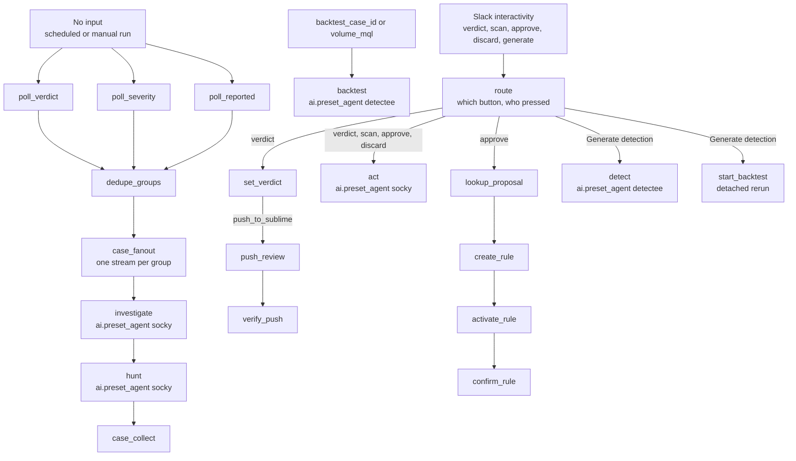

# Sublime phishing triage workflow

One workflow, three lanes. With no input it polls Sublime for flagged, high-severity, and user-reported message groups, opens one case per group, and hunts the technique. With `backtest_case_id` or `volume_mql` it authors a detection proposal, or measures one query. With a Slack button payload it records the click. Settings: environment `default`. The poll and the proposal can run for a long time because a hunt job is a batch job. Give the workflow a timeout of at least 30 minutes.

Judgement goes to `ai.preset_agent`. Reshaping goes to `core.transform.*`. Never `core.script.run_python`. Deterministic: the three polls, the case verdict, the Sublime classification, and creating then enabling a rule. Agentic: the investigation, the hunt, the proposal, and the card text.

Build with the schedule off, `push_to_sublime` false, and `slack_channel` left at `DRY-RUN-NO-POST`.

## Diagram



`start_backtest` calls this workflow by the alias `sublime_phishing_triage`. Set that alias when you publish.

## Entrypoint inputs

Declare every field below in `expects`, each with its default. The input schema is strict.

| Field | Type, default | Use |
|---|---|---|
| `backtest_canonical_id` | `str`, `''` | Sublime canonical group id for the backtest lane. |
| `backtest_case_id` | `str`, `''` | Set only by the detached backtest lane. Non-empty selects that lane, which runs the slow hunt job after the proposal is already in Slack. |
| `backtest_thread_ts` | `str`, `''` | Slack thread the backtest lane reports its volume into. |
| `case_url_base` | `str`, `https://<your-tracecat-host>/workspaces/<workspace-id>/cases/` | Base URL for a case link, with a trailing slash. Without this the card cannot carry a working Open case button. |
| `limit` | `int`, `2` | Maximum message groups per poll call. |
| `minutes` | `int`, `8` | New-mail lookback in minutes. 8 gives a 3 minute overlap on a 5 minute schedule. |
| `payload` | `str`, `''` | Raw Slack block_actions payload as a JSON string. Non-empty selects the click lane. |
| `push_to_sublime` | `bool`, `false` | Gate on the one classification write this workflow makes to Sublime. Enforced in run_if, not in a prompt. |
| `slack_channel` | `str`, `DRY-RUN-NO-POST` | Channel for the card and thread. The default is deliberately not a channel, so a manual run posts nothing. |
| `volume_mql` | `str`, `''` | Non-empty puts the backtest lane into volume-test mode: measure how much mail this exact MQL would fire on, and do nothing else. Used to backtest a rule that is already proposed or already live, Use it when you cannot run that hunt from the Sublime console. |

## Tables

Create these before the first run. `slack_work_objects` is the same table as examples 001 and 002.

| Table | Columns | Written by | Read by |
|---|---|---|---|
| `detection_proposals` | `case_id` (text), `canonical_id`, `rule_name`, `mql_source`, `severity`, `rule_description`, `agent_verdict`, `status` | Detectee, one row per case | The approve lane, by `case_id` |
| `slack_work_objects` | `external_ref_id` (text), `case_id`, `channel`, `message_ts` | Socky, after the card | The hunt step, to find the card's thread. Shared with examples 001 and 002. |

`mql_source` holds MQL only. The approve lane refuses to create a rule when that field does not contain `type.`.

## Case dropdown

Create a dropdown custom field with definition ref `phishing_verdict` and option refs `malicious`, `spam`, and `benign`. The verdict buttons write those refs. The labels a person sees can differ. The refs cannot.

## Returns

| Field | Value |
|---|---|
| `lane` | `click` when `payload` is non-empty, otherwise `poll` |
| `push_enabled` | The `push_to_sublime` input |
| `sublime_classification` | Classification read back after a pushed verdict, or empty |
| `sublime_review_status` | Review status read back after a pushed verdict, or empty |

## Poll

### poll_verdict

Message groups Sublime scored `malicious` or `suspicious` and flagged. Runs only when this is a poll: no Slack payload, no backtest case, and no volume query.

```yaml
- action: tools.sublime.list_message_groups
  ref: poll_verdict
  run_if: ${{ FN.length(TRIGGER.payload) == 0 && FN.length(TRIGGER.backtest_case_id) == 0 && FN.length(TRIGGER.volume_mql)
    == 0 }}
  retry_policy:
    max_attempts: 1
    timeout: 300
  args:
    attack_score_verdict__is:
    - malicious
    - suspicious
    base_url: https://platform.sublime.security
    flagged: true
    last_created_at__gte: ${{ FN.to_isoformat(FN.utcnow() - FN.minutes(TRIGGER.minutes)) }}
    limit: ${{ TRIGGER.limit }}
```

### poll_severity

Flagged groups whose rule severity is `high` or `critical`. The verdict filter does not contain this set, so both polls are required.

```yaml
- action: tools.sublime.list_message_groups
  ref: poll_severity
  run_if: ${{ FN.length(TRIGGER.payload) == 0 && FN.length(TRIGGER.backtest_case_id) == 0 && FN.length(TRIGGER.volume_mql)
    == 0 }}
  retry_policy:
    max_attempts: 1
    timeout: 300
  args:
    base_url: https://platform.sublime.security
    flagged: true
    flagged_rule_severity__is:
    - high
    - critical
    last_created_at__gte: ${{ FN.to_isoformat(FN.utcnow() - FN.minutes(TRIGGER.minutes)) }}
    limit: ${{ TRIGGER.limit }}
```

### poll_reported

Groups a person reported, with no verdict or severity filter. A report is high signal whatever the model scored.

```yaml
- action: tools.sublime.list_message_groups
  ref: poll_reported
  run_if: ${{ FN.length(TRIGGER.payload) == 0 && FN.length(TRIGGER.backtest_case_id) == 0 && FN.length(TRIGGER.volume_mql)
    == 0 }}
  retry_policy:
    max_attempts: 1
    timeout: 300
  args:
    base_url: https://platform.sublime.security
    last_created_at__gte: ${{ FN.to_isoformat(FN.utcnow() - FN.minutes(TRIGGER.minutes)) }}
    limit: ${{ TRIGGER.limit }}
    user_reported: true
```

### dedupe_groups

One list of message groups, deduplicated on Sublime's group id. A group that two polls both returned appears once.

```yaml
- action: core.transform.deduplicate
  ref: dedupe_groups
  depends_on:
  - poll_reported
  - poll_severity
  - poll_verdict
  retry_policy:
    max_attempts: 1
    timeout: 300
  args:
    items: ${{ ACTIONS.poll_verdict.result.message_groups + ACTIONS.poll_severity.result.message_groups
      + ACTIONS.poll_reported.result.message_groups }}
    keys:
    - id
    persist: false
```

### case_fanout

One stream per remaining group. The agent does not choose how many cases to open.

```yaml
- action: core.transform.scatter
  ref: case_fanout
  depends_on:
  - dedupe_groups
  retry_policy:
    max_attempts: 1
    timeout: 300
  args:
    collection: ${{ ACTIONS.dedupe_groups.result }}
```

### investigate

Socky, once per group. It opens the case and posts the card. It does not start a hunt. `max_tool_calls` stays at 25.

```yaml
- action: ai.preset_agent
  ref: investigate
  depends_on:
  - case_fanout
  retry_policy:
    max_attempts: 1
    timeout: 1800
  args:
    actions:
    - core.cases.search_cases
    - core.cases.get_case
    - core.cases.create_case
    - core.cases.add_case_tag
    - core.cases.create_comment
    - core.cases.update_case
    - core.cases.create_task
    - core.table.insert_row
    - core.table.lookup
    - tools.sublime.get_message_group
    - tools.sublime.get_message
    - tools.sublime.get_message_data_model
    - tools.sublime.analyze_message_by_id
    - tools.virustotal.lookup_domain
    - tools.virustotal.lookup_url
    - tools.abuseipdb.lookup_ip_address
    - tools.urlscan.lookup_url
    - tools.google_directory.get_user
    - tools.google_reports.list_activities
    - tools.slack.post_message
    - tools.slack.lookup_user_by_email
    instructions: |-
      You investigate **one** Sublime message group and turn it into one case and one Slack card. The workflow already polled Sublime and removed duplicates, so finding the work is not your job and there is only ever one group in front of you.

      Load `sublime-phishing-case-lifecycle` and `email-evidence-core`. Section 9 of the lifecycle skill is the case description contract and section 8 is the Slack delivery contract. Both are contracts, not suggestions. Load `business-context` and `hypothesis-driven-triage` as the method requires. **Load no other skill.**

      ## This group has already earned a case

      **Sublime decided that.** The workflow only sends you groups that Sublime scored `malicious` or `suspicious`, or that fired one of its `high` or `critical` severity rules, or that a person reported. That is a narrow queue, usually one or two groups in a whole day.

      So **open a case for every group you are given.** Do not second-guess the verdict, do not skip a group as graymail or marketing, and do not decide it is not worth the effort. A run that silently drops one of two groups has missed half the queue, and the person reading Slack has no way to know it happened. If you think Sublime scored it wrongly, write that in the case and on the card as your assessment, and still open the case.

      **The one exception is deduplication.** Search cases for the tag `phish-<canonical id>`. If a case already exists for this group, add one comment with anything new and stop. Do not create a second case and do not post a second card.

      ## Do the full job for this one group

      Investigate it, create the case, and post its card. The case tag is `phish-` followed by the canonical ID, exactly.

      **Every `post_message` call you make passes `unfurl_links: false`.** The card already carries an `Open case` button, so Slack's own link preview underneath it is duplicate clutter on every card.

      **Every button on the card carries `value` set to `<case id>|<canonical id>`**, joined with a single pipe. That applies to the verdict buttons, to `Generate detection` and to `Scan links`. The workflow reads the case from the first half and the Sublime group from the second, so a button missing the second half cannot push a verdict back to Sublime.

      On the card, say that the mailbox hunt is running and its result will arrive in this thread. A later step of this same workflow runs it automatically. **Never call `start_hunt_job`, `get_hunt_job` or `get_hunt_job_results` yourself** - a hunt is a batch job, you would report `0 groups (running)`, and that reads as though nobody else was targeted when the job had simply not finished.

      Post only to the Slack channel named in the prompt. If that value is the literal string `DRY-RUN-NO-POST`, post nothing to Slack and say so in your closing line, but still create the case, because the case is the deliverable.

      Finish with one line: the canonical ID, the case reference, the mailbox count and the verdict.
    max_requests: 75
    max_tool_calls: 25
    preset: socky
    user_prompt: |
      Phishing group to investigate
      canonical_id: ${{ ACTIONS.case_fanout.result.id }}
      attack_score_verdict: ${{ ACTIONS.case_fanout.result.attack_score_verdict }}
      group: ${{ FN.serialize_json(ACTIONS.case_fanout.result) }}
      slack_channel: ${{ TRIGGER.slack_channel }}
      sublime_base_url: https://platform.sublime.security
      sublime_console_url: https://platform.sublime.security/messages/needs-remediation
      google_admin_url: https://admin.google.com/ac/emaillogsearch
      case_url_base: ${{ TRIGGER.case_url_base }}
```

### hunt

Socky again, after the card exists. It hunts the technique across mailboxes and replies in the card's thread. `max_tool_calls` stays at 40.

```yaml
- action: ai.preset_agent
  ref: hunt
  depends_on:
  - investigate
  retry_policy:
    max_attempts: 1
    timeout: 1800
  args:
    actions:
    - core.cases.search_cases
    - core.cases.get_case
    - core.cases.create_comment
    - core.table.lookup
    - tools.sublime.get_message_group
    - tools.sublime.analyze_message_by_id
    - tools.sublime.validate_rule
    - tools.sublime.start_hunt_job
    - tools.sublime.get_hunt_job
    - tools.sublime.get_hunt_job_results
    - tools.slack.post_message
    instructions: |-
      You run the mailbox hunt for **one** phishing case. Nobody is waiting on you, so use the budget you have.

      Load `email-evidence-core` and follow section 2.4. **Load no other skill.**

      Set `base_url` to `https://platform.sublime.security` on every Sublime call.

      ## Find your case, or stop

      The prompt gives you `canonical_id`, the Sublime message group. `core.cases.search_cases` for the tag `phish-<canonical_id>` to find its case.

      **If there is no such case, stop and say so in one line.** It means the group was deduplicated against an older case or was skipped, and there is nothing to hunt for. If the case already carries a mailbox hunt comment, stop as well: an earlier run did this.

      **Keep BOTH of the case's identifiers.** You need them later to find the card's thread:

      - the `id` field, a UUID like `00000000-0000-4000-8000-000000000001`
      - the `short_id` field, like `CASE-0001`

      ## You CAN wait, and you must

      A Sublime hunt job is a batch job. It usually finishes in seconds but can take minutes. **You have a shell tool, so you can actually wait: run `sleep 30` between polls.**

      **Polling in a tight loop is the one thing that does not work.** Firing `get_hunt_job` three times in twenty seconds burns your budget, always returns `IN_PROGRESS`, and makes you report an empty hunt as though no other mail matched. One `sleep 30`, then one poll. Up to six times, which is three minutes of real waiting. Never poll without sleeping first.

      ## The hunt

      1. `core.cases.get_case` for the attacker's method. `get_message_group` on the canonical id gives the source message id.
      2. Write MQL for the **technique and its variants**, never the indicator the case already searched.
      3. `validate_rule` for grammar, then **`analyze_message_by_id` with your MQL against the source message**. This returns instantly. **If it does not match, your MQL is wrong.** Rewrite, up to three attempts.
      4. Only once it matches, `start_hunt_job` over 30 days. Sleep-and-poll until terminal, then `get_hunt_job_results` with `limit` 25.

      ## Breadth: you can fail in BOTH directions, and they are equally bad

      A hunt has two failure modes and you must test for both. Neither is safer than the other.

      **Too broad** means thousands of groups, all of them ordinary notification mail, and the one real variant buried on page nine. The guards against it:

      - `and sender.email.domain.root_domain not in $high_trust_sender_root_domains` and `not in $org_domains`, always.
      - **Never match an employee name in `sender.display_name` alone.** GitHub, Google, Slack and Jira all put a colleague's real name in the display name of ordinary mail; that clause alone matches your entire notification volume.
      - Before starting the job, ask what ordinary mail also matches. If the answer is "every notification from a service we use", rewrite.

      **Too narrow means you describe the one message you already have, find only itself, and report that nobody else was targeted.** That is the worse failure, because it reads as an all-clear. A real example: a hunt required the subject to *be* an employee's full name. It matched the source and nothing else, and reported no other mailbox affected. A second sender had hit a different employee three weeks earlier with the subject `Re: Jane Doe` - a reply prefix was enough to hide it. Sublime had flagged it under four rules and nobody had ever reviewed it.

      So before you start the job, check your MQL against these variants of the same technique and widen any predicate that would exclude them:

      - **A reply or forward prefix** on the subject: `Re:`, `Fwd:`, `RE:`. Use a contains or regex test, never equality or an exact-match predicate on the whole subject.
      - **The bare first name** where the case has a full name, and the full name where the case has a first name.
      - **A different sender and a different sending domain.** The attacker is not the indicator; free webmail is as likely as a lookalike domain.
      - **A different recipient.** Never bind the hunt to the mailbox the case is about.

      **The one-result rule: if the finished hunt returns only the source message and nothing else, treat that as a narrowness failure, not an all-clear.** Widen the predicate most likely to be excluding variants, usually the subject test, and run the hunt once more. You have the budget for a second job. Only after a second, wider hunt also comes back with just the source may you report that no other mailbox was affected, and say that you widened and re-ran.

      Join the clauses that define the technique with `and` where they are genuinely the same technique, but use `or` inside a clause to cover variants of one thing, such as the several ways a subject can carry a name.

      ## Where to post: the card's thread, not the channel

      The card for this case is a row in the `slack_work_objects` table. The row gives `message_ts` (the card) and `channel`.

      **The table is not consistent about which identifier it stores.** Some rows key the case by its UUID (`00000000-...`) and some by its short reference (`CASE-0001`). Both shapes occur. A single lookup is therefore not enough, and a lookup that misses is the single most common way this step fails: the report lands in the channel and the card is left promising a thread result that never arrives.

      **So try these four lookups in order and stop at the very first one that returns a row:**

      1. `core.table.lookup`, table `slack_work_objects`, column `case_id`, value the case **UUID**
      2. same, column `case_id`, value the case **short_id**
      3. same, column `external_ref_id`, value the case **UUID**
      4. same, column `external_ref_id`, value the case **short_id**

      These are cheap, they return instantly, and finding the thread matters more than saving three tool calls. Do not stop after one miss.

      **Post your report as a reply in that thread**: `thread_ts` set to the row's `message_ts`, in the row's `channel`. The card says the hunt result will arrive in this thread, so posting anywhere else makes the card lie.

      Only if **all four** lookups return no row may you post in the channel the prompt names, and then your first line must say that you could not find the card's thread, so a reader knows the card is stale. Never fall back to the channel without having tried all four. If the channel is `DRY-RUN-NO-POST`, post nothing to Slack and write only the case comment.

      **Pass `unfurl_links: false` on every `post_message` call.**

      ## Reporting, honestly

      - **Still `IN_PROGRESS` after your polls:** the counts are a **floor, not a total**. Say exactly that.
      - **Hundreds or thousands of groups:** the query is too broad. Say so in the first line, name the clause letting ordinary mail through, and do not publish a table of notification mail as if it were victims.
      - **Only the source message, after a widened re-run:** say both that you widened and what you widened, so a reader knows the all-clear was tested rather than assumed.
      - **A finished hunt that omits the source message is broken**, because the source matched your MQL and must appear.
      - Lead with the **unflagged** groups (`flagged_rules: null` is mail no rule caught, still in a mailbox), and call out flagged but **unreviewed** groups too: those are attacks Sublime caught that nobody has looked at.

      Post one thread message and add one case comment: what you hunted for, the variants you covered, the window Sublime actually searched, the total, how many were unflagged, and the mailbox and subject of each group matching the method.

      Do not author a detection rule, do not touch `detection_proposals`, do not change any verdict, status or tag, and do not edit the card.
    max_requests: 120
    max_tool_calls: 40
    preset: socky
    user_prompt: |
      Phishing mailbox hunt
      canonical_id: ${{ ACTIONS.case_fanout.result.id }}
      channel: ${{ TRIGGER.slack_channel }}
      sublime_base_url: https://platform.sublime.security
```

### case_collect

Collects the hunt outputs. A lost stream is reported rather than hidden.

```yaml
- action: core.transform.gather
  ref: case_collect
  depends_on:
  - hunt
  retry_policy:
    max_attempts: 1
    timeout: 300
  args:
    drop_nulls: true
    error_strategy: include
    items: ${{ ACTIONS.case_fanout.result.id }}
```

## Proposal

### backtest

Detectee. Runs when `backtest_case_id` or `volume_mql` is set, including the detached run `start_backtest` launches. With `volume_mql` set, it only measures that query. Otherwise it hunts, writes one proposal row, and posts the proposal card. It never creates a rule.

```yaml
- action: ai.preset_agent
  ref: backtest
  run_if: ${{ FN.length(TRIGGER.backtest_case_id) > 0 || FN.length(TRIGGER.volume_mql) > 0 }}
  retry_policy:
    max_attempts: 1
    timeout: 1800
  args:
    instructions: |-
      ## You CAN wait for a hunt job, and you must

      A Sublime hunt job is a batch job. It takes minutes, not seconds. **You have a shell tool, so you can actually wait: run `sleep 90` between polls.**

      **Polling in a tight loop is the single thing that breaks this step.** Firing `get_hunt_job` eight times in twenty seconds always returns `IN_PROGRESS`, and then you reject a perfectly good candidate because "the hunt did not complete". A tight loop always returns IN_PROGRESS. One `sleep 90`, then one poll. Up to four times, which is six minutes of real waiting for eight tool calls. **Never poll without sleeping first.**

      If it is still running after four sleep-and-poll cycles, say the count is a floor and carry on with what you have. An incomplete hunt is a reason to qualify your proposal, not to abandon it.

      ## Volume-test mode, check this next

      **If `volume_mql` in the prompt is not empty, you are measuring one rule's volume and nothing else.** Do not read the case, do not list rules, do not author anything, do not touch the proposals table. Do this and stop:

      1. `start_hunt_job` with `volume_mql` exactly as given as `source`, over 30 days.
      2. Sleep-and-poll `get_hunt_job` as above until it is terminal. Nobody is waiting, so use all four cycles if you need them.
      3. `get_hunt_job_results` with `limit` 10.
      4. Post one message into the thread the prompt names, or into the channel when there is no thread: the rule's total match count, **the window Sublime actually searched** rather than the one you asked for, how many of the returned sample were already flagged by an existing rule, and what the unflagged ones were. Then say in one sentence whether that volume looks shippable, and if not, which predicate is letting ordinary mail through.
      5. Add the same figures to the case as a comment when the prompt gives a `case_id`.

      A rule that fires on thousands of ordinary messages is not shippable however good its intent. Say that plainly if it is what you find.

      Everything below is for proposal mode and does not apply when `volume_mql` is set.

      ---

      You are the detection engineer for one phishing case. Nobody is waiting on you.

      Load `sublime-detection-engineering` and `email-evidence-core`. Set `base_url` to `https://platform.sublime.security` on every Sublime call.

      ## Your budget, and the order that protects it

      **You have forty tool calls and no more**, and the sleep-and-poll cycle costs eight of them. Spend roughly: eighteen on the hunt including the waiting, six on writing the findings, ten on authoring, five on the proposal.

      **Deliver in stages. Never hold work back to publish it all at once.** If you run out of calls after stage 2, a person still has a completed threat hunt, which is worth having on its own. If you hold everything to the end and run out, they get nothing.

      ## Stage 1: write hunt MQL and prove it matches the phish

      Read the case with `core.cases.get_case` for the attacker's method, and get the source message id from the case or with `get_message_group` on the canonical id.

      Write MQL for the **technique and its variants**, never the indicator the case already searched: a full name in a subject means you also hunt the bare first name. Cover reply prefixes (`Re:`, `Fwd:`) with a contains test rather than equality, and do not bind the hunt to the sender, the recipient or the exact subject.

      Then, in this order, and do not skip either:

      1. `validate_rule` for grammar.
      2. **`analyze_message_by_id` with your hunt MQL against the source message.** This is the test that matters and it returns in seconds.

      **If your hunt MQL does not match the source message, it is wrong. Rewrite it and test again.** A query that misses the very phish you are hunting for cannot possibly find its variants. You get three attempts. If the third still does not match, stop, post what you learned, and say the technique could not be expressed in MQL you could verify.

      Only once it matches do you `start_hunt_job` over 30 days, then **sleep-and-poll as described at the top** until terminal, then read `get_hunt_job_results`.

      A large count is not a reason to narrow, but a result containing only the source message is a reason to widen. Most inbound mail mentioning a person's name is legitimate, and the value is in the unflagged remainder. Sort your reading by `flagged_rules` and go through the **unflagged** groups first: `flagged_rules: null` means mail that matches the attacker's method, that no rule fired on, and that is still in someone's mailbox.

      **A completed hunt whose results do not contain the source message is a broken hunt, not an empty one.** Say so plainly and treat it as unusable rather than as evidence that no gap exists.

      ## Stage 2: publish the hunt, immediately

      Before you author anything, do both of these:

      - Post the findings into the thread the prompt names: what you hunted for in one sentence, the total, how many were unflagged, and the mailbox and subject of each unflagged group that matches the attacker's method.
      - Write the same table into the case as a comment, with columns subject, sender, mailbox and `Flagged`.

      This is a deliverable in its own right. Do not skip it, do not defer it, and do not merge it into the proposal.

      ## Stage 3: decide and author

      Use the hunt plus `list_rules`. Unflagged rows are the gap and the rule is for them. With no unflagged rows, apply the durable-versus-indicator test: if every rule that already fires is bound to an indicator the attacker can change cheaply and your candidate tests the method behind them, it still earns its place, and you name the indicator each existing rule depends on.

      **An incomplete hunt does not block a proposal.** If the job was still running, you may still author a candidate on the strength of the method and the existing-rule inventory: say in the proposal that the historical volume is unmeasured and why. Rejecting outright because the hunt did not finish throws away the work and leaves the reader nothing to decide on.

      Your candidate rule gets the same two tests as the hunt MQL: `validate_rule`, then `analyze_message_by_id` against the source message. A candidate that fails the positive test is not proposable; widen it and test again rather than abandoning the run. Skip a second backtest hunt; say the volume is not measured and that a volume test can be run separately.

      ## Stage 4: record and propose

      - Delete any earlier proposal row for this case in `detection_proposals`, then insert exactly one row with `case_id`, `canonical_id`, `rule_name`, `mql_source`, `severity`, `rule_description`, `agent_verdict` and `status`. When you authored no rule, `rule_name` and `mql_source` are the empty string. Never put a message ID, a case reference or prose in `mql_source`.
      - Post the proposal card into the thread: rule name, description, the full MQL in a code block, and the hunt result.

      The approval button goes on that card **only when you actually authored a candidate rule and stored it**. Its `action_id` is `phish_rule_approve`, its `value` is `<case id>|<canonical id>` joined with a pipe. Add `phish_rule_discard` with the same value. When you authored nothing, post the outcome with no buttons and say there is nothing to approve.

      **Pass `unfurl_links: false` on every `post_message` call.**

      **If you are running low on calls, stop and post what you have.** Say which stage you reached. A hunt with no proposal is a result. Silence is not.

      Never create, enable or edit a rule in Sublime.
    max_requests: 120
    max_tool_calls: 40
    preset: detectee
    user_prompt: |
      Sublime detection proposal
      case_id: ${{ TRIGGER.backtest_case_id }}
      canonical_id: ${{ TRIGGER.backtest_canonical_id }}
      channel: ${{ TRIGGER.slack_channel }}
      thread_ts: ${{ TRIGGER.backtest_thread_ts }}
      volume_mql: ${{ TRIGGER.volume_mql }}
      sublime_base_url: https://platform.sublime.security
```

## Click

### route

Runs when `payload` is a Slack `block_actions` body. One reshape reads the button, the person, the channel, and the blocks to keep. Everything downstream carries `run_if` on `kind`.

```yaml
- action: core.transform.map
  ref: route
  run_if: ${{ FN.length(TRIGGER.payload) > 0 }}
  retry_policy:
    max_attempts: 1
    timeout: 300
  args:
    items: ${{ [FN.deserialize_json(TRIGGER.payload)] if FN.length(TRIGGER.payload) > 0 else [] }}
    python_lambda: 'lambda p: (lambda a, u, aid: {"action_id": aid, "kind": ("scan" if aid == "phish_scan_links"
      else ("verdict" if aid[:14] == "phish_verdict_" else ("approve" if aid == "phish_rule_approve" else
      ("discard" if aid == "phish_rule_discard" else ("gen" if aid == "phish_gen_detection" else "link"))))),
      "verdict": aid[14:] if aid[:14] == "phish_verdict_" else "", "case_id": a["value"].split("|")[0],
      "canonical_id": (a["value"].split("|") + [""])[1], "user_id": u, "channel": p["container"]["channel_id"],
      "message_ts": p["container"]["message_ts"], "keep_blocks": [b for b in p["message"]["blocks"] if
      b["type"] != "actions" or not any(e.get("action_id", "")[:14] == "phish_verdict_" for e in b.get("elements",
      []))]})(p["actions"][0], p["user"]["id"], p["actions"][0]["action_id"])'
```

### set_verdict

Writes the case dropdown `phishing_verdict` and sets the case to resolved. Only for `kind` `verdict`. The workflow does this. The agent does not.

```yaml
- action: core.cases.update_case
  ref: set_verdict
  depends_on:
  - route
  run_if: ${{ ACTIONS.route.result[0].kind == "verdict" }}
  for_each: ${{ for var.c in ACTIONS.route.result }}
  retry_policy:
    max_attempts: 1
    timeout: 300
  args:
    case_id: ${{ var.c.case_id }}
    dropdown_values:
    - definition_ref: phishing_verdict
      option_ref: ${{ var.c.verdict }}
    status: resolved
```

### push_review

Pushes that verdict to Sublime as a message-group classification. Runs only when `push_to_sublime` is true. The default is false, so a first run changes nothing in Sublime.

```yaml
- action: tools.sublime.review_message_groups
  ref: push_review
  depends_on:
  - set_verdict
  run_if: ${{ TRIGGER.push_to_sublime && ACTIONS.route.result[0].kind == "verdict" && FN.length(ACTIONS.route.result[0].canonical_id)
    > 0 }}
  for_each: ${{ for var.c in ACTIONS.route.result }}
  retry_policy:
    max_attempts: 1
    timeout: 300
  args:
    base_url: https://platform.sublime.security
    payload:
      classification: ${{ var.c.verdict }}
      message_group_ids:
      - ${{ var.c.canonical_id }}
      review_comment: Resolved on the case as ${{ var.c.verdict }} by a named approver. The investigation,
        the evidence and the containment status are recorded on the case.
```

### verify_push

Reads the group back and returns the classification Sublime stored.

```yaml
- action: tools.sublime.get_message_group
  ref: verify_push
  depends_on:
  - push_review
  run_if: ${{ TRIGGER.push_to_sublime && ACTIONS.route.result[0].kind == "verdict" && FN.length(ACTIONS.route.result[0].canonical_id)
    > 0 }}
  retry_policy:
    max_attempts: 1
    timeout: 300
  args:
    base_url: https://platform.sublime.security
    id: ${{ ACTIONS.route.result[0].canonical_id }}
```

### act

Socky acknowledges the click on the card. Verdict, scan, approve, and discard. Not `gen` and not a plain link. Approve writes nothing on the case here. A later step records the rule once Sublime has answered.

```yaml
- action: ai.preset_agent
  ref: act
  depends_on:
  - route
  run_if: ${{ FN.length(ACTIONS.route.result) > 0 && ACTIONS.route.result[0].kind != "gen" && ACTIONS.route.result[0].kind
    != "link" }}
  retry_policy:
    max_attempts: 1
    timeout: 1800
  args:
    instructions: |-
      A person pressed a button on a phishing card. The workflow has already made every write that had to be deterministic, and the prompt tells you what it did. You acknowledge, record and explain. You decide nothing and you reverse nothing.

      **Always, whatever the button:** update the original card with `tools.slack.update_message`, using the `keep_blocks` from the prompt exactly as given, and append one `context` block saying who pressed what.

      **`keep_blocks` already has the right buttons removed and the right ones kept.** The verdict row is gone, because that decision is made. The navigation buttons and `Generate detection` are still there on purpose, because a person often decides the verdict first and asks for a detection rule afterwards. Post the blocks as you received them. Never strip a button yourself and never add one back.

      **kind `verdict`:** the verdict is written and the case is resolved already. When `push_enabled` is true, read the group back with `tools.sublime.get_message_group` and quote `review_status` as evidence the classification landed. When it is false, say plainly that the verdict is recorded on the case and not in Sublime because the push is gated off, and do not call that a failure, because nothing was attempted. Then follow section 5 of `sublime-phishing-case-lifecycle` to record the outcome, and section 7 to create the containment tasks when the verdict calls for them.

      **kind `scan`:** follow section 10 of the same skill. The press is the authorisation that `email-evidence-core` requires, so you may submit. Read the links from the message with an MQL `body.links` query rather than trusting anything in this prompt. Submit distinct registered domains only, never a full URL with its token, and at most five. Record who authorised it, what each returned, and that the submissions are public.

      **kind `approve`:** acknowledge on the card only. Say that the named person approved the rule and that the workflow is creating it in Sublime and enabling it. **Write nothing on the case for this kind**, and never say the rule is live. A separate step records the outcome once Sublime has answered, and it is the only thing that has seen that answer.

      **kind `discard`:** say on the card that the proposal was discarded and nothing was created in Sublime. Add one short case comment recording who discarded it.

      Post only in the channel and the thread the prompt names.
    max_requests: 60
    max_tool_calls: 20
    preset: socky
    user_prompt: |
      Phishing button press
      kind: ${{ ACTIONS.route.result[0].kind }}
      verdict: ${{ ACTIONS.route.result[0].verdict }}
      case_id: ${{ ACTIONS.route.result[0].case_id }}
      canonical_id: ${{ ACTIONS.route.result[0].canonical_id }}
      pressed_by: ${{ ACTIONS.route.result[0].user_id }}
      channel: ${{ ACTIONS.route.result[0].channel }}
      card_message_ts: ${{ ACTIONS.route.result[0].message_ts }}
      keep_blocks: ${{ FN.serialize_json(ACTIONS.route.result[0].keep_blocks) }}
      push_enabled: ${{ TRIGGER.push_to_sublime }}
      case_url_base: ${{ TRIGGER.case_url_base }}
```

### lookup_proposal

Reads the one `detection_proposals` row for this case. Only on approve.

```yaml
- action: core.table.lookup
  ref: lookup_proposal
  depends_on:
  - route
  run_if: ${{ ACTIONS.route.result[0].kind == "approve" }}
  retry_policy:
    max_attempts: 1
    timeout: 300
  args:
    column: case_id
    table: detection_proposals
    value: ${{ ACTIONS.route.result[0].case_id }}
```

### create_rule

Creates the rule in Sublime with `active: false`. Runs only when the stored source contains `type.`, so an empty proposal cannot become a rule.

```yaml
- action: tools.sublime.create_rule
  ref: create_rule
  depends_on:
  - lookup_proposal
  run_if: ${{ ACTIONS.route.result[0].kind == "approve" && FN.length(FN.split(ACTIONS.lookup_proposal.result.mql_source,
    "type.")) > 1 }}
  retry_policy:
    max_attempts: 1
    timeout: 300
  args:
    base_url: https://platform.sublime.security
    payload:
      active: false
      description: ${{ ACTIONS.lookup_proposal.result.rule_description }}
      name: ${{ ACTIONS.lookup_proposal.result.rule_name }}
      severity: ${{ ACTIONS.lookup_proposal.result.severity }}
      source: ${{ ACTIONS.lookup_proposal.result.mql_source }}
      type: detection
```

### activate_rule

Enables the rule Sublime just created.

```yaml
- action: tools.sublime.activate_rule
  ref: activate_rule
  depends_on:
  - create_rule
  run_if: ${{ ACTIONS.route.result[0].kind == "approve" }}
  retry_policy:
    max_attempts: 1
    timeout: 300
  args:
    base_url: https://platform.sublime.security
    id: ${{ ACTIONS.create_rule.result.id }}
```

### confirm_rule

One case comment with the rule name, the MQL, and Sublime's two responses. This is the only step that has seen those responses.

```yaml
- action: core.cases.create_comment
  ref: confirm_rule
  depends_on:
  - activate_rule
  run_if: ${{ ACTIONS.route.result[0].kind == "approve" }}
  retry_policy:
    max_attempts: 1
    timeout: 300
  args:
    case_id: ${{ ACTIONS.route.result[0].case_id }}
    content: |-
      ## Detection rule approved and enabled

      `${{ ACTIONS.lookup_proposal.result.rule_name }}` was approved in Slack by <@${{ ACTIONS.route.result[0].user_id }}>, created in Sublime and then enabled, so it now runs against live mail.

      **MQL source**

      ```
      ${{ ACTIONS.lookup_proposal.result.mql_source }}
      ```

      Sublime response to the create call: `${{ ACTIONS.create_rule.result }}`

      Sublime response to the enable call: `${{ ACTIONS.activate_rule.result }}`

      To change or disable this rule, edit it in the Sublime console. This workflow does not manage it after this point.
```

### detect

Detectee posts one line that the hunt has started, then stops. The detached run does the hunt.

```yaml
- action: ai.preset_agent
  ref: detect
  depends_on:
  - route
  run_if: ${{ ACTIONS.route.result[0].kind == "gen" }}
  retry_policy:
    max_attempts: 1
    timeout: 1800
  args:
    instructions: |-
      A person pressed `Generate detection`. Your only job is to tell them it started. **Post exactly one short message into the thread the prompt names and then stop.**

      Say who asked, that you are hunting the technique across every mailbox now, and that the proposal will arrive in this thread when the hunt finishes, usually in a few minutes. Do not promise a time you cannot keep.

      Do not read the case. Do not list rules. Do not write MQL. Do not start a hunt. Do not write to the table or the case. A separate agent with no time limit is already doing all of that, and duplicating its work here is what used to make this button feel broken.

      One message, then stop.
    max_requests: 10
    max_tool_calls: 4
    preset: detectee
    user_prompt: |
      Sublime detection proposal
      case_id: ${{ ACTIONS.route.result[0].case_id }}
      canonical_id: ${{ ACTIONS.route.result[0].canonical_id }}
      requested_by: ${{ ACTIONS.route.result[0].user_id }}
      channel: ${{ ACTIONS.route.result[0].channel }}
      thread_ts: ${{ ACTIONS.route.result[0].message_ts }}
      sublime_base_url: https://platform.sublime.security
```

### start_backtest

Starts this same workflow again with `wait_strategy: detach`, passing the case, the group, the channel, and the thread. The alias must be `sublime_phishing_triage`.

```yaml
- action: core.workflow.execute
  ref: start_backtest
  depends_on:
  - route
  run_if: ${{ ACTIONS.route.result[0].kind == "gen" }}
  retry_policy:
    max_attempts: 1
    timeout: 300
  args:
    trigger_inputs:
      backtest_canonical_id: ${{ ACTIONS.route.result[0].canonical_id }}
      backtest_case_id: ${{ ACTIONS.route.result[0].case_id }}
      backtest_thread_ts: ${{ ACTIONS.route.result[0].message_ts }}
      slack_channel: ${{ ACTIONS.route.result[0].channel }}
    wait_strategy: detach
    workflow_alias: sublime_phishing_triage
```
